# Minggu 2 - Declarative UI & Responsive Design

| | |
|---|---|
| **Nama** | Rani Miftahus Saadah |
| **NIM** | 244107020057 |
| **Kelas** | TI_3F |
| **Mata Kuliah** | Pemrograman Mobile |
| **Program Studi** | Teknik Informatika, Politeknik Negeri Malang |
| **Tanggal** | [ISI TANGGAL] |

## 1. Tujuan

Membangun halaman **Academic Overview**, sebuah dashboard mahasiswa yang:

- menampilkan **1 kolom** pada layar sempit dan **2 kolom** pada layar lebar,
- mendukung **tema terang dan gelap** dengan toggle manual,
- memakai `Row`, `Column`, `Expanded`, dan `Container`,
- memiliki **label aksesibilitas** pada elemen penting,
- dilengkapi widget test dan refactoring sesuai codelab Minggu 2.

## 2. Fitur Utama

- Header profil mahasiswa (avatar, nama, NIM, program studi).
- Empat kartu informasi: Assignments, Attendance, Portfolio, Current week.
- Layout responsif memakai `LayoutBuilder` dengan breakpoint 700 (`kWideBreakpoint`).
- Toggle tema memakai `CupertinoSwitch`; state dikelola `StatefulWidget`.
- Warna dan tipografi memakai `Theme.of(context)`.
- Label `Semantics` pada toggle, header profil, dan setiap kartu.
- Dua widget test untuk perilaku responsif.

## 3. Stack Teknologi

- Flutter (Material 3) dan Dart
- Widget utama: `LayoutBuilder`, `GridView.count`, `Card`, `CupertinoSwitch`, `Semantics`, `ExcludeSemantics`
- Testing: `flutter_test`
- Perangkat uji: [ISI: misal HP Android M2101K7BNY]

## 4. Hasil Praktikum

### 4.1 Warm-up: Kartu Profil

Sebelum membuat dashboard, saya melatih widget dasar dengan kartu profil sederhana. Kartu memakai `Container` (ukuran, padding, dekorasi), `Column` (susunan vertikal), `Row` (susunan horizontal), dan `Expanded` (pembagian ruang tersisa).

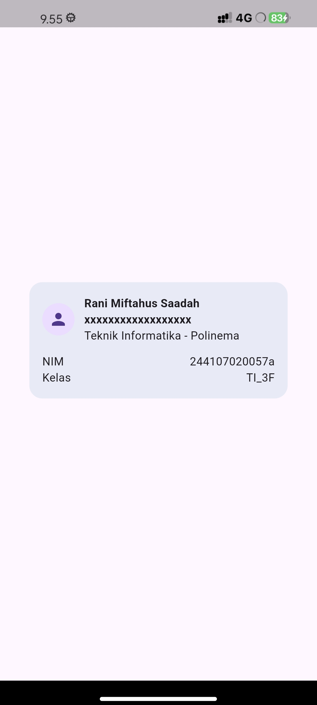

**Eksperimen warm-up:**

| No | Eksperimen | Hasil pengamatan |
|---|---|---|
| 1 | Menghapus `Expanded` pada baris nama | Teks yang panjang tidak membungkus dan meluber keluar kartu; muncul garis kuning-hitam *RIGHT OVERFLOWED BY ... PIXELS*. |
| 2 | Menghapus `mainAxisSize: MainAxisSize.min` | Tinggi `Column` terluar mengikuti ruang maksimum sehingga kartu tidak lagi pas dengan isinya. |
| 3 | Menambah baris `Email` | Berhasil dengan pola `Row` + `Expanded` yang sama seperti baris NIM dan Kelas. |

Eksperimen 1: tanpa `Expanded`

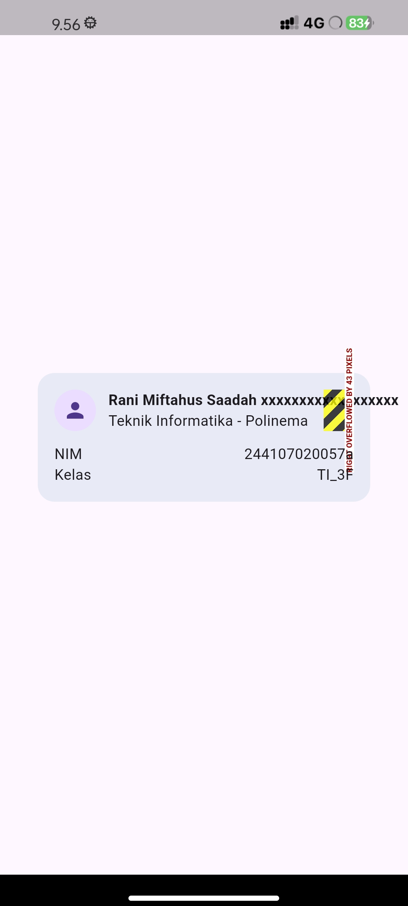

Eksperimen 2: tanpa `mainAxisSize.min`

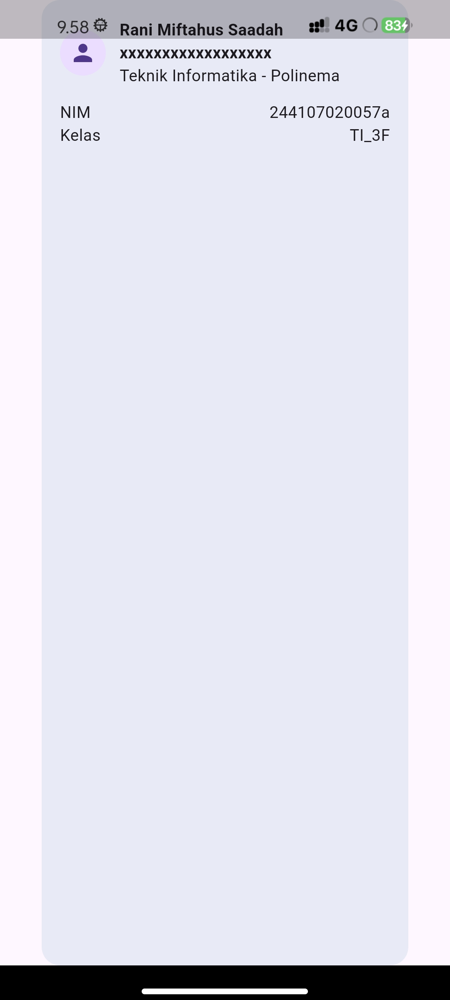

Eksperimen 3: menambah baris Email

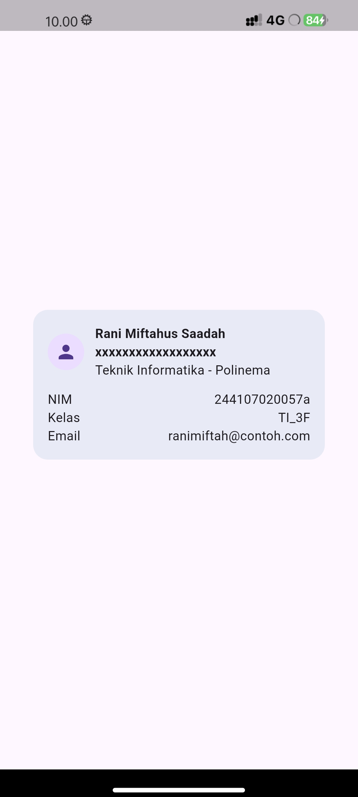

**Penjelasan:** `Row` memberi anak yang tidak fleksibel batas lebar tak terbatas pada sumbu utamanya. Tanpa `Expanded`, `Column` di samping avatar tidak mendapat batas lebar, sehingga teks tidak membungkus dan dapat meluber bila lebih panjang dari ruang yang tersisa. Dengan `Expanded`, `Row` terlebih dahulu menempatkan avatar dan jarak, lalu memaksa `Column` mengisi seluruh sisa lebar (sekitar 236 px pada kartu selebar 320 px). Karena batas lebarnya kini pasti, teks yang panjang otomatis turun ke baris berikutnya.

### 4.2 Dashboard Responsif

Jumlah kolom ditentukan oleh `LayoutBuilder` berdasarkan lebar yang tersedia:

```dart
const double kWideBreakpoint = 700;

// di dalam LayoutBuilder
final columns = constraints.maxWidth >= kWideBreakpoint ? 2 : 1;
```

Halaman terdiri atas `ProfileHeader` di atas dan `GridView.count` di bawahnya (dibungkus `Expanded` agar mengisi sisa tinggi layar).

| Layar sempit (1 kolom) | Layar lebar (2 kolom, HP landscape) |
|---|---|
| 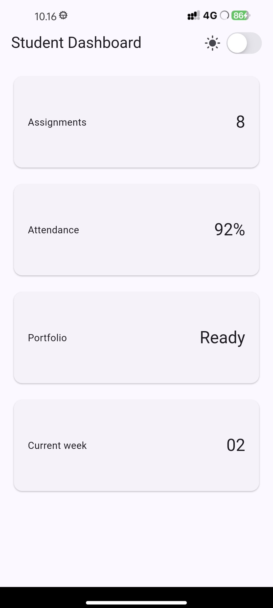 | 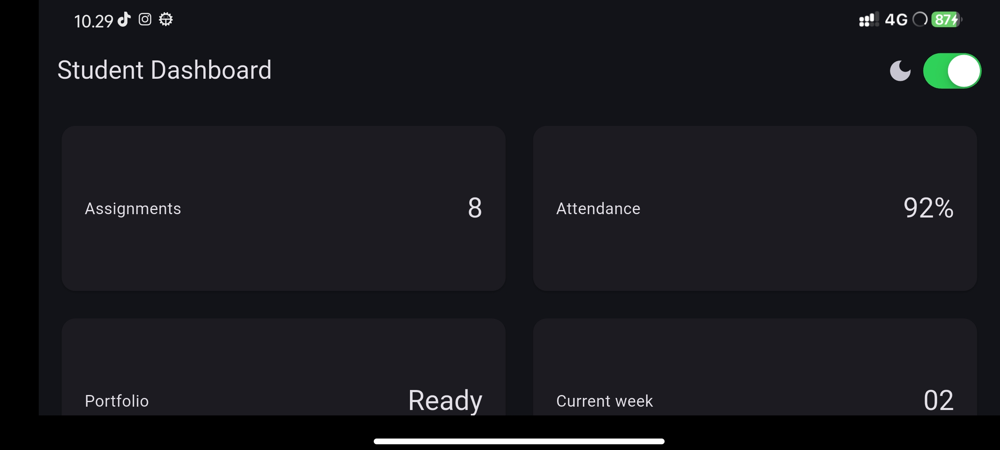 |

### 4.3 Tema Terang dan Gelap

Tema diatur melalui `theme`, `darkTheme`, dan `themeMode` pada `MaterialApp`. Toggle `CupertinoSwitch` di AppBar mengubah state `isDark` pada `StatefulWidget`, lalu `MaterialApp` dibangun ulang dengan tema yang sesuai.

```dart
themeMode: isDark ? ThemeMode.dark : ThemeMode.light,
```

Warna header dan teks diambil dari `ColorScheme` (`primaryContainer` dan `onPrimaryContainer`), sehingga kontras tetap terbaca di kedua tema (lihat tampilan gelap pada bagian 6.4).

### 4.4 Eksperimen Layout

| No | Eksperimen | Hasil pengamatan |
|---|---|---|
| 1 | Breakpoint diubah dari `700` menjadi `300` | Karena lebar HP dalam posisi portrait sudah di atas 300, layar kecil yang tadinya 1 kolom menjadi 2 kolom. Ini membuktikan jumlah kolom hanya bergantung pada nilai breakpoint. Nilai dikembalikan ke `700`. |
| 2 | `themeMode` diubah menjadi `ThemeMode.dark` | Aplikasi selalu gelap. Toggle masih bergerak tetapi tema tidak berubah, karena `themeMode` tidak lagi membaca `isDark`. |
| 3 | `themeMode` diubah menjadi `ThemeMode.system` | Tema mengikuti pengaturan mode gelap perangkat. Toggle tidak berpengaruh pada tema. Setelah itu dikembalikan ke `isDark ? ThemeMode.dark : ThemeMode.light`. |
| 4 | Ukuran layar berbeda | HP portrait menampilkan 1 kolom, HP landscape menampilkan 2 kolom (lihat bagian 6.2). |

Eksperimen 1: breakpoint 700 menjadi 300

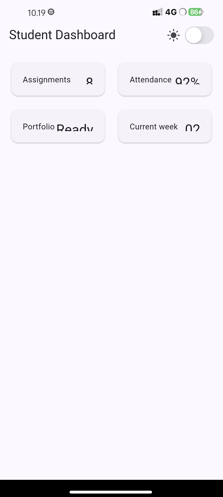

Eksperimen 2: `ThemeMode.dark`

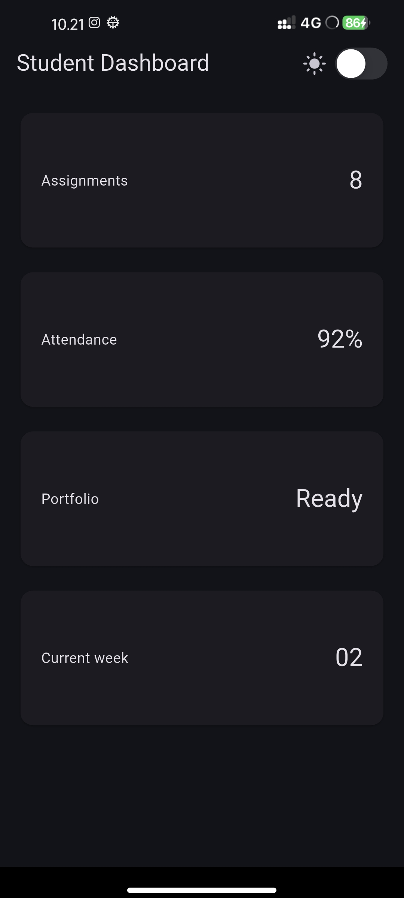

Eksperimen 3: `ThemeMode.system`

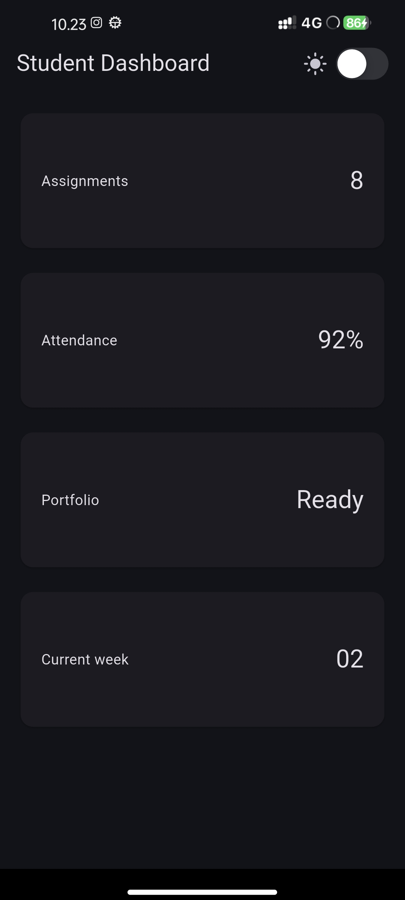

### 4.5 Aksesibilitas

- Toggle tema dibungkus `Semantics(label: 'Mode gelap')` agar screen reader membacanya sebagai saklar mode gelap, bukan saklar tanpa nama.
- Ikon matahari/bulan diberi `ExcludeSemantics` karena hanya dekoratif.
- Header profil diberi label ringkasan: nama, NIM, dan program studi.
- Setiap `InfoCard` diberi `Semantics(container: true, label: '<judul>: <nilai>')` sehingga terbaca sebagai satu informasi, misalnya "Attendance: 92%".
- Informasi tidak hanya disampaikan melalui warna; setiap kartu memiliki teks judul dan nilai.

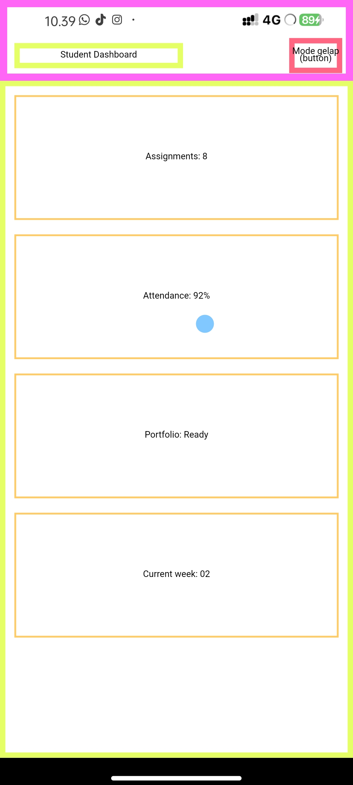

## 5. Penjelasan Kode Penting

| Bagian | Fungsi |
|---|---|
| `kWideBreakpoint = 700` | Satu-satunya definisi breakpoint, mudah diubah |
| `LayoutBuilder` | Membaca lebar yang tersedia lalu menentukan jumlah kolom |
| `GridView.count` | Menyusun kartu dalam grid dengan jumlah kolom dinamis |
| `InfoCard` | Widget reusable untuk kartu informasi (`title` dan `value`) |
| `ProfileHeader` | Header profil memakai `Container`, `Row`, `Column`, `Expanded` |
| `Theme.of(context)` | Warna dan gaya teks mengikuti tema terang/gelap secara otomatis |
| `StatefulWidget` pada `DashboardApp` | Menyimpan state `isDark` |
| `CupertinoSwitch` | Contoh widget Cupertino di aplikasi Material |
| `Semantics` + `ExcludeSemantics` | Label screen reader yang jelas tanpa bacaan ganda |

## 6. Pengujian

Dua widget test memverifikasi perilaku responsif dengan mengubah ukuran layar lewat `tester.view`:

| Test | Ukuran layar | Yang diverifikasi | Hasil |
|---|---|---|---|
| Dashboard satu kolom di layar sempit | 400 x 800 | Lebar kartu kurang dari 700 | Lulus |
| Dashboard dua kolom di layar lebar | 1200 x 800 | Lebar kartu lebih dari 500 | Lulus |

```powershell
flutter analyze   # No issues found!
flutter test      # All tests passed!
```

`flutter analyze`

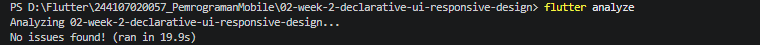

`flutter test`

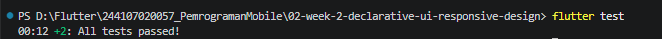

## 7. Refactoring

Setelah tugas utama berjalan, kode dirapikan sesuai Refactoring challenge:

| No | Perubahan | Sebelum | Sesudah |
|---|---|---|---|
| 1 | Kartu menjadi widget reusable | `DashboardCard` | `InfoCard(title, value)` dipakai empat kali |
| 2 | Warna dan ukuran dari tema | `TextStyle(fontSize: 20, ...)` | `textTheme.titleLarge?.copyWith(...)`, `textTheme.bodyMedium`, `scheme.primary`, `scheme.onPrimary` |
| 3 | Breakpoint menjadi konstanta | angka `700` langsung di kode | `const double kWideBreakpoint = 700;` |
| 4 | Pemeriksaan statis | - | `flutter analyze` tanpa error maupun warning baru |

Tampilan aplikasi tetap sama sebelum dan sesudah refactor; yang berubah hanya struktur kode.

## 8. AI Prompt Challenge

AI dipakai setelah implementasi mandiri selesai, hanya untuk membandingkan alternatif tata letak, memperkuat konsep `Expanded`, dan mengaudit rekomendasinya sendiri.

### Prompt 1: Desain

**Prompt:** "Bandingkan dua tata letak dashboard akademik untuk Flutter: versi `GridView` dan versi `LayoutBuilder` + `Column`. Jelaskan trade-off responsif dan aksesibilitasnya."

**Ringkasan output:** `GridView` lebih ringkas dan hanya merender item yang terlihat, tetapi tinggi kartu terikat `childAspectRatio` sehingga berisiko saat font diperbesar. `LayoutBuilder` + `Column` mengikuti isi kartu dan lebih aman untuk font besar, tetapi kodenya lebih panjang dan scroll harus dibuat manual.

**Keputusan:** [ISI: misal diterima sebagian, tetap memakai `GridView.count`].
**Alasan teknis:** [ISI: misal dashboard hanya berisi 4 kartu dengan isi pendek, sehingga `GridView.count` lebih sederhana; risiko font besar dicatat].

### Prompt 2: Penguatan konsep

**Prompt:** "Jelaskan kapan penggunaan `Expanded` justru menyebabkan overflow di dalam `Row`, beri contoh kode yang gagal dan perbaikannya."

**Ringkasan output:**

| Kasus | Penyebab | Perbaikan |
|---|---|---|
| `Expanded` di `Row` dalam scroll horizontal | Lebar tak terbatas, tidak ada sisa ruang untuk dibagi | Beri batas lebar atau buang `Expanded` |
| `Expanded` di `Column` dalam `ListView` | Tinggi tak terbatas | Buang `Expanded` atau beri tinggi tetap |
| `Expanded` dibungkus `Padding` | Bukan child langsung dari `Row`/`Column`/`Flex` | Pindahkan `Expanded` ke luar |
| Saudara berukuran tetap melampaui ruang | Total ukuran tetap lebih besar dari lebar layar | Jadikan semuanya fleksibel, atau pakai `Wrap`/scroll |

**Keputusan:** Diterima sebagai penguat konsep.
**Alasan teknis:** Penjelasan kasus lebar tak terbatas konsisten dengan eksperimen warm-up (bagian 6.1): saat `Expanded` dihapus, `Column` tidak mendapat batas lebar sehingga teks meluber.

### Prompt 3: Verifikasi

**Prompt:** "Periksa kembali rekomendasi layout di atas: apakah tetap responsif di bawah 600px, apakah mengurangi aksesibilitas, dan apakah ada widget yang tidak tersedia di Flutter stabil saat ini?"

**Ringkasan output:**

1. **Responsif di bawah 600 px:** ya, karena jumlah kolom ditentukan `constraints.maxWidth >= 700`, sehingga lebar di bawah 700 selalu 1 kolom.
2. **Aksesibilitas:** AI mengoreksi saran awalnya. `mainAxisExtent` tetap tidak ikut membesar saat font diperbesar, sehingga tidak lebih baik dari `childAspectRatio` untuk kasus font besar. Alternatif yang lebih kuat adalah menskalakan tinggi dengan `MediaQuery.textScalerOf(context)` atau memakai versi `Column`.
3. **Ketersediaan widget:** `LayoutBuilder`, `GridView.count`, `CupertinoSwitch`, `Semantics`, dan `ExcludeSemantics` tersedia di Flutter stabil. `TextScaler` membutuhkan Flutter 3.16 atau lebih baru.

**Keputusan:** [ISI]
**Alasan teknis:** [ISI]

### Bukti verifikasi

| Pemeriksaan | Hasil |
|---|---|
| Lebar layar di bawah 700 (HP portrait) | 1 kolom |
| Lebar layar di atas 700 (HP landscape) | 2 kolom |
| Font sistem diperbesar ke maksimum | [ISI: overflow atau tidak] |
| `flutter analyze` | No issues found |
| `flutter test` | All tests passed |

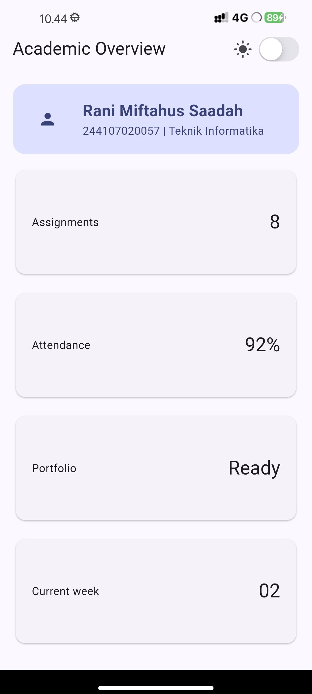

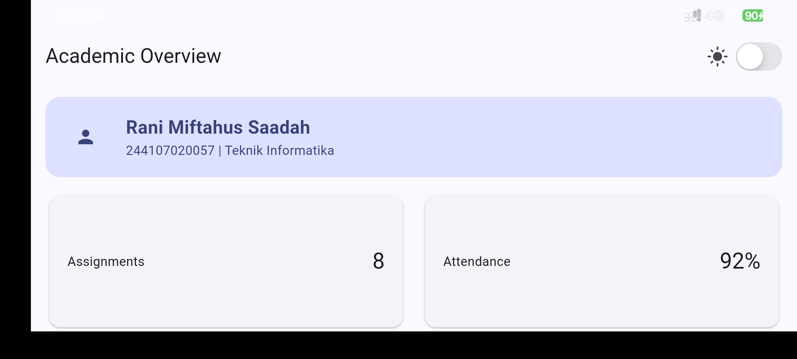

**Temuan verifikasi:** Rekomendasi AI tidak diterapkan mentah-mentah. Saran `mainAxisExtent` tetap dikoreksi oleh AI sendiri saat diaudit, sehingga kode `GridView.count` dipertahankan. 

## 9. Refleksi

**Apa perbedaan cara berpikir imperative dan declarative saat membangun UI?**
Pada pendekatan imperative, developer mengubah elemen UI satu per satu ketika data berubah. Pada pendekatan declarative, developer mendeskripsikan tampilan berdasarkan state saat ini, dan Flutter membangun ulang bagian yang relevan ketika state berubah. Pada tugas ini, toggle tema hanya mengubah `isDark` lewat `setState`, lalu `themeMode` pada `MaterialApp` membaca nilai tersebut. Tidak ada kode yang mengubah warna widget satu per satu.

**Kapan `Expanded` membantu dan kapan penggunaannya justru menghasilkan layout error?**
`Expanded` membantu membagi sisa ruang di dalam `Row` atau `Column`, misalnya agar teks panjang membungkus alih-alih meluber. Pada eksperimen warm-up, menghapus `Expanded` membuat `Column` di samping avatar tidak punya batas lebar sehingga teks overflow. Sebaliknya, `Expanded` bisa menimbulkan error jika sumbu utamanya tidak terbatas (misalnya `Row` di dalam scroll horizontal atau `Column` di dalam `ListView`), atau jika `Expanded` bukan child langsung dari `Row`/`Column`/`Flex`.

**Bagaimana breakpoint dan theme memengaruhi pengalaman pengguna?**
Breakpoint memastikan informasi tetap nyaman dibaca di layar kecil maupun besar: satu kolom di layar sempit agar kartu tidak terlalu sempit, dan dua kolom di layar lebar agar ruang tidak terbuang. Eksperimen mengubah breakpoint ke 300 menunjukkan bahwa nilai ini langsung menentukan kapan layout berganti. Theme yang terpusat membuat tampilan konsisten, dan dark mode membantu kenyamanan di lingkungan gelap, selama kontras warna tetap terjaga. Karena itu warna header diambil dari `ColorScheme`, bukan warna tetap.

## 10. Kesimpulan

Pada minggu ini saya membangun halaman Academic Overview yang responsif (1 kolom pada layar sempit, 2 kolom pada layar lebar), mendukung tema terang dan gelap dengan toggle, serta memiliki label aksesibilitas. Praktikum ini memperjelas cara kerja `Expanded` pada `Row`, peran `LayoutBuilder` dalam layout responsif, dan manfaat memusatkan warna serta tipografi pada `Theme`. Kendala yang muncul (struktur folder, tes bawaan, izin instalasi di HP, finder `Card`, dan Git) menjadi pelajaran tentang membaca pesan error dengan teliti.