# Minggu 3 - Navigation & State Management

| | |
|---|---|
| **Nama** | Rani Miftahus Saadah |
| **NIM** | 244107020057 |
| **Kelas** | TI_3F |
| **Mata Kuliah** | Pemrograman Mobile |
| **Program Studi** | Teknik Informatika, Politeknik Negeri Malang |

## 1. Tujuan

Membangun aplikasi **ToDo** dengan navigasi multi-halaman (GoRouter) dan state management (Riverpod), termasuk penanganan state asinkron dengan `AsyncValue` (loading, error, success) dan pengujian dengan widget test serta unit test.

## 2. Fitur Utama

- **Praktikum 1:** navigasi dua halaman dengan GoRouter, path parameter `detail/:id`, dan akses path langsung.
- **Aplikasi ToDo:** tambah, centang, dan hapus tugas. Daftar utama hanya menampilkan tugas yang belum selesai; state dikelola `Notifier` dan provider turunan, UI memakai `ConsumerWidget`, dan tampilan tiap baris dipisah menjadi `TodoTile`.
- **Halaman Statistik:** `AsyncNotifier` yang mensimulasikan pengambilan data (jeda 2 detik, gagal sekitar 30%) dengan tampilan loading, error + tombol Coba lagi, dan success.
- **Navigasi:** GoRouter memakai `StatefulShellRoute.indexedStack` dan `NavigationBar` untuk tab `/` (ToDo) dan `/stats` (Statistik), serta route detail `/todo/:index`.
- State tugas tetap ada saat berpindah tab selama aplikasi berjalan; daftar belum disimpan secara persisten.

## 3. Stack Teknologi

- Flutter dan Dart
- `go_router` ^16.2.1 (versi terkunci 16.3.0)
- `flutter_riverpod` ^3.4.3 (versi terkunci 3.4.3)
- Testing: `flutter_test`
- Perangkat uji: Android (M2101K7BNY) dan Google Chrome untuk akses path langsung

## 4. Hasil Praktikum

### 4.1 Praktikum 1: Aplikasi Multi-page dengan GoRouter

Project `week3_navigation` memiliki dua halaman: `HomePage` (daftar Item 1-10) dan `DetailPage` yang dibuka lewat path `/detail/:id`. Aplikasi memakai `MaterialApp.router` dengan `routerConfig`.

| Home | Detail |
|---|---|
| 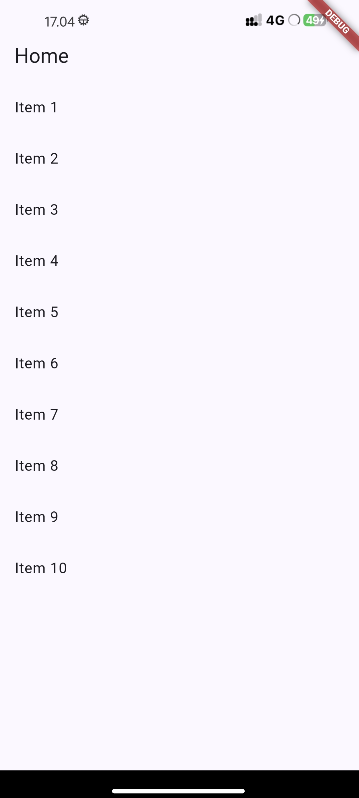 |  |

**Akses path langsung (Chrome):** setelah membuka satu item, angka pada URL diubah dan halaman detail terbuka tanpa melewati Home.

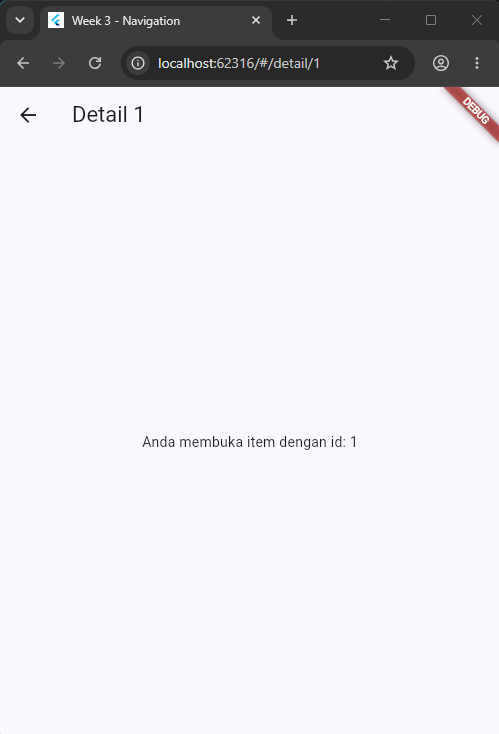

**Pengamatan:**

- Route `detail/:id` merupakan child route dari `/`. Saat item diketuk, aplikasi memanggil `context.go('/detail/<id>')`; AppBar detail menyediakan tombol kembali ke Home.
- Path detail bisa diakses langsung di browser tanpa melewati Home. Screenshot Chrome memperlihatkan URL `localhost:62316/#/detail/1`, dengan ID item sebagai bagian dari path setelah hash.
- Di browser, hash URL (`/#/detail/1`) menunjukkan route Flutter Web; pada aplikasi native route yang sama dipakai tanpa tampilan address bar browser.

### 4.2 Praktikum 2: Aplikasi ToDo dengan Riverpod

`ProviderScope` membungkus aplikasi. State tugas disimpan di `TodoListNotifier` (`Notifier<List<Todo>>`) dan ditampilkan oleh `TodoPage` (`ConsumerWidget`).

| Belum ada tugas | Dialog tugas baru | Daftar tugas |
|---|---|---|
| 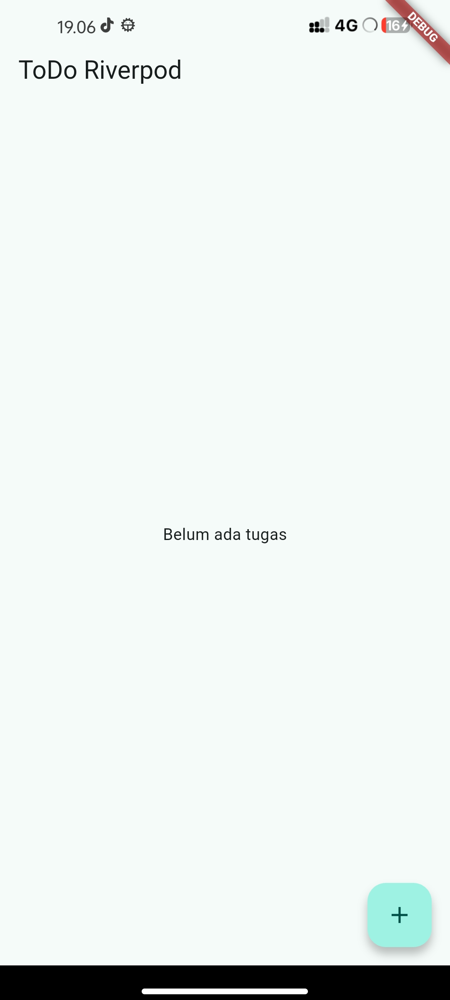 | 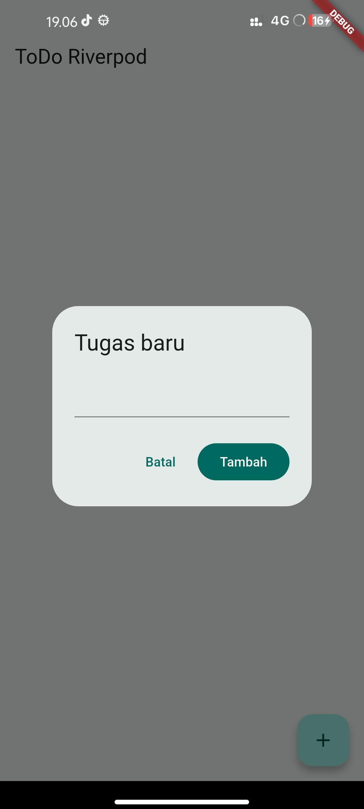 | 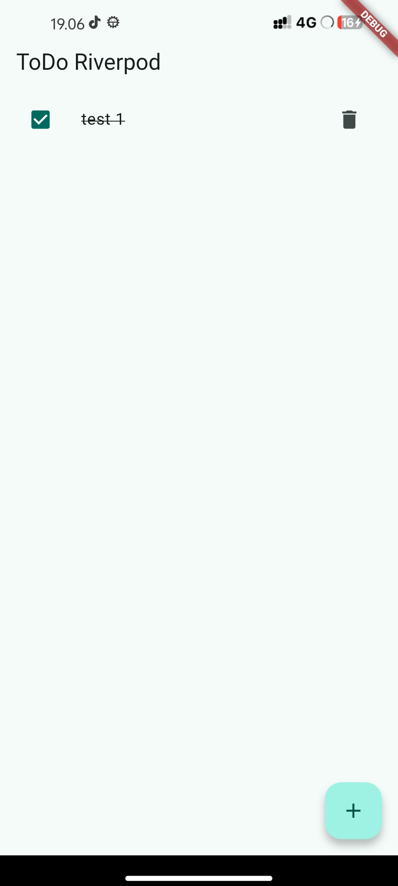 |

**Konsep yang dipakai:**

| Konsep | Penerapan |
|---|---|
| `ref.watch(incompleteTodosProvider)` di dalam `build` | Halaman berlangganan hasil filter, jadi otomatis ter-rebuild saat daftar sumber berubah |
| `incompleteTodosProvider` membaca `todoListProvider` | Provider turunan memilih tugas dengan `done == false`; tugas selesai tidak tampil pada daftar utama |
| `ref.read(todoListProvider.notifier)` di dalam callback | Memanggil method (`add`, `toggle`, `remove`) tanpa membuat widget berlangganan pada notifier |
| State immutable | Setiap perubahan membuat list baru (`[...state, Todo(title)]`), tidak ada `state.add()`, sehingga Riverpod dapat mendeteksi perubahan |

Screenshot praktikum ini berasal dari tahap sebelum filter tugas belum selesai diterapkan; karena itu gambar daftar masih memperlihatkan tugas yang sudah dicentang. Pada implementasi refactoring saat ini, tugas selesai disembunyikan dari daftar utama oleh `incompleteTodosProvider`.

### 4.3 Praktikum 3: Tiga State AsyncValue

`ProductsNotifier` (`AsyncNotifier<List<String>>`) mensimulasikan pengambilan data dengan jeda 2 detik. `ProductPage` menampilkan tiga state lewat `when(loading, error, data)`.

| Loading | Success | Error |
|---|---|---|
| 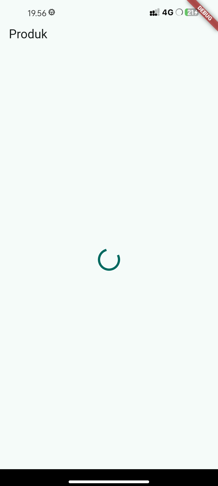 | 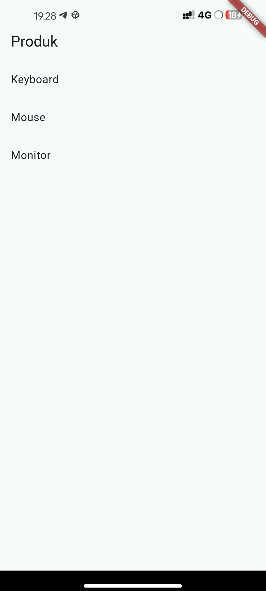 | 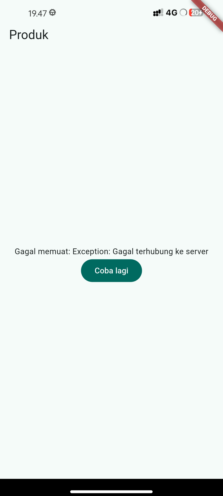 |

- **Loading:** jeda diperpanjang sementara menjadi 10 detik agar spinner sempat difoto, lalu dikembalikan ke 2 detik.
- **Error:** untuk mengambil screenshot, `build()` dibuat melempar `Exception('Gagal terhubung ke server')`. UI menampilkan pesan gagal dan tombol **Coba lagi**.
- **Pemulihan:** setelah baris `throw` dihapus, tombol Coba lagi memanggil `ref.invalidate(productsProvider)`. Provider dijalankan ulang sehingga state kembali loading lalu success.

Screenshot praktikum ini mendokumentasikan percobaan `ProductsNotifier`/`ProductPage`. Implementasi Statistik pada refactoring adalah provider yang terpisah (`StatsNotifier`/`StatsPage`) dan memiliki simulasi gagal acak sekitar 30%.

**Refleksi stale data:** Jika pemuatan ulang mempertahankan data terakhir sambil menampilkan indikator refresh, pengguna tetap dapat membaca informasi yang sudah ada ketika jaringan lambat. Untuk aplikasi ini, UI menampilkan state loading baru saat provider di-invalidate; mempertahankan stale data belum diterapkan.

## 5. AI Prompt Challenge

Halaman Statistik dibuat dengan bantuan AI coding assistant di VS Code.

**Prompt:**

```
Buatkan halaman Flutter bernama StatsPage menggunakan flutter_riverpod.
Requirements:
- ConsumerWidget dengan satu AsyncNotifierProvider yang mensimulasikan
  pengambilan data statistik (delay 2 detik, kadang gagal 30%).
- UI harus menangani loading (spinner), error (pesan + tombol retry),
  dan success (ListView 3 item).
- Berikan unit test untuk notifier-nya.
Jelaskan setiap bagian kode dalam komentar.
```

**Hasil AI (halaman Statistik berjalan):**

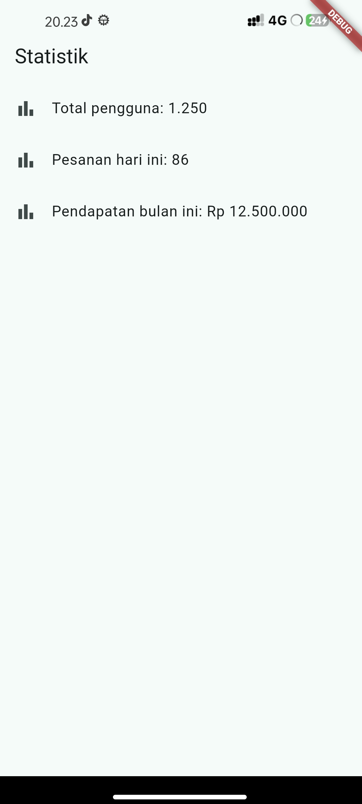

**Hasil yang dihasilkan AI:** `StatsPage` (`ConsumerWidget`), `StatsNotifier` (`AsyncNotifier<List<String>>`) dengan `statsProvider`, dan dua unit test di `stats_provider_test.dart` (jalur sukses dan jalur error).

**Verifikasi sesuai checklist:**

| Pemeriksaan | Hasil | Catatan |
|---|---|---|
| State immutable, tanpa `state.add()` | Lolos | Hasil sukses berupa list `const` |
| `ref.watch` hanya di `build`, `ref.read`/`invalidate` di callback | Lolos | `watch` di `build`, tombol Coba lagi memakai `ref.invalidate` |
| Tiga state `AsyncValue` ditangani | Lolos | `when` memiliki `loading`, `error`, dan `data` |
| Provider bertipe eksplisit, tidak duplikat | Lolos | `AsyncNotifierProvider<StatsNotifier, List<String>>`, satu deklarasi |
| Tidak memakai API Riverpod lama | Lolos | Tidak ada `StateProvider` atau `StateNotifierProvider` |
| `flutter analyze` dan `flutter test` | Lolos | Screenshot hasil pada tahap challenge ada di bagian 7; test diperluas lagi pada refactoring |

**Temuan saat verifikasi:**

1. **Teks error kurang ramah.** Implementasi masih melempar `StateError`, sehingga pesan UI memuat awalan `Bad state:`. Ini terlihat di screenshot Statistik error pada bagian 6 dan belum diganti dengan pesan yang lebih ramah pengguna.
2. **Teks error menempel di tepi layar.** Pada screenshot Statistik error di bagian 6, pesan tampak rata kiri dan dekat tepi layar. UI belum diberi padding atau perataan teks khusus; ini menjadi perbaikan tampilan yang belum diterapkan.
3. **Desain yang mendukung pengujian.** Jeda (`waitForResponse`) dan peluang gagal (`shouldFail`) dipisahkan menjadi anggota yang bisa di-override, sehingga tes dapat memaksa jalur sukses dan error tanpa menunggu 2 detik dan tanpa hasil acak.

## 6. Refactoring

Aplikasi ToDo diintegrasikan dengan GoRouter: `/` untuk daftar tugas, `/stats` untuk statistik, serta `/todo/:index` untuk detail tugas. `StatefulShellRoute.indexedStack` menjaga dua tab di dalam shell; route detail berada sebagai route anak pada branch ToDo. `NavigationBar` berpindah branch melalui `navigationShell.goBranch`.

| Tab ToDo | Statistik error | Statistik success |
|---|---|---|
| 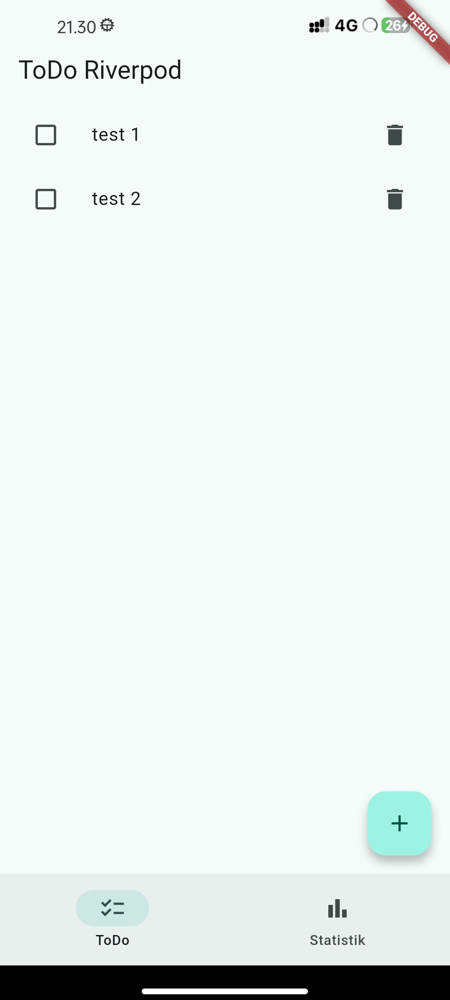 | 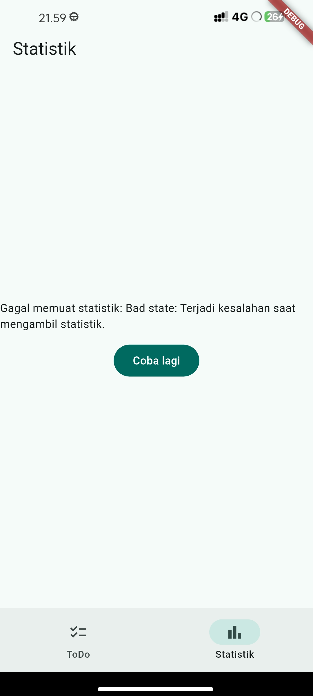 | 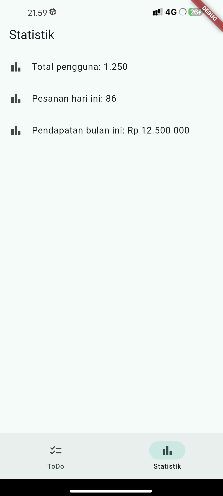 |

**Pengamatan:**

- Berpindah dari tab Statistik kembali ke tab ToDo tidak menghapus tugas selama aplikasi berjalan. `ProviderScope` membungkus root aplikasi dan state daftar dikelola Riverpod; data tidak disimpan lintas restart.
- Halaman Statistik menampilkan tiga state: spinner selama 2 detik, tiga statistik saat berhasil, atau pesan error dengan tombol Coba lagi (gagal acak sekitar 30%).
- `navigationShell.goBranch` dipakai untuk berpindah tab. `context.push('/todo/$index')` menumpuk halaman detail di atas daftar; tombol kembali mengembalikan pengguna ke daftar.
- Route detail membaca tugas dari state memori berdasarkan indeks. Path detail bisa dibuka langsung, tetapi hanya menampilkan tugas jika indeks itu tersedia pada state aplikasi.

## 7. Pengujian

| Tes | File | Yang diverifikasi | Hasil |
|---|---|---|---|
| Widget: tambah tugas dan navigasi | `widget_test.dart` | Tambah tugas, tab ToDo/Statistik, route detail langsung, dan tombol kembali | Lulus |
| Widget: state halaman Statistik | `stats_page_test.dart` | Loading, data sukses, pesan error, dan tombol retry | Lulus |
| Unit: stats sukses dan error | `stats_provider_test.dart` | Tiga statistik saat sukses; error diteruskan saat gagal | Lulus |
| Unit: filter tugas | `todo_provider_test.dart` | Hanya tugas belum selesai yang dikembalikan provider turunan | Lulus |
| Widget: item tugas | `todo_tile_test.dart` | Tampilan tugas serta callback toggle dan hapus | Lulus |

Hasil setelah AI Challenge:

| `flutter analyze` | `flutter test` |
|---|---|
| 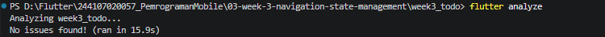 |  |

Hasil setelah refactoring:

| `flutter analyze` | `flutter test` |
|---|---|
| 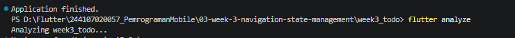 |  |

Screenshot terminal tersebut merekam hasil pemeriksaan saat diambil. Setelah itu pengujian diperluas untuk route detail dan state UI Statistik; validasi terakhir pada implementasi tersebut menghasilkan `flutter analyze` tanpa issue dan seluruh 7 test lulus.

## 8. Refleksi

**Kapan `setState` masih cukup, dan kapan state harus naik ke Riverpod?**
`setState` cukup untuk state lokal satu widget, misalnya status buka/tutup satu panel. Ketika state perlu dipakai oleh halaman lain, seperti daftar tugas di dalam shell navigasi, Riverpod menyediakan satu sumber state bersama sehingga tidak perlu diteruskan lewat banyak widget. Pada aplikasi ini daftar tetap ada ketika berpindah tab, tetapi tidak bertahan setelah aplikasi dimulai ulang.

**Apa perbedaan `context.go` dan `context.push`, dan kapan masing-masing tepat digunakan?**
`go` berpindah ke lokasi tertentu, sedangkan `push` menambahkan halaman di atas halaman saat ini sehingga dapat dikembalikan dengan tombol back. Pada aplikasi ini perpindahan tab memakai `navigationShell.goBranch`; detail tugas dibuka dengan `context.push`.

**Bagaimana `AsyncValue` mencegah bug dibanding tiga boolean terpisah?**
`AsyncValue` memodelkan loading, error, dan data sebagai satu tipe, sehingga kombinasi yang mustahil (misalnya `isLoading` dan `hasError` sama-sama benar) tidak bisa terjadi. Metode `when` juga memaksa ketiga kondisi ditangani, jadi layar putih saat API gagal lebih mudah dihindari.

**Bagian mana dari hasil AI yang Anda perbaiki, dan mengapa?**
Hasil AI diuji dan diintegrasikan dengan alur aplikasi, termasuk provider statistik ke `StatsPage`, tab GoRouter, serta test deterministik dengan override untuk jalur sukses dan error. Saya juga memisahkan item tugas menjadi `TodoTile` dan filter tugas belum selesai menjadi provider turunan. Saat meninjau UI error, saya menemukan teks `Bad state:` dan padding yang belum memadai; keduanya dicatat sebagai kekurangan yang masih perlu diperbaiki, bukan diklaim sudah selesai.

## 9. Kesimpulan

Pada minggu ini saya membangun aplikasi ToDo dengan navigasi GoRouter dan state management Riverpod. Praktikum ini memperjelas perbedaan `ref.watch` dan `ref.read`, pentingnya state yang immutable, serta bagaimana `AsyncValue` menyederhanakan penanganan loading, error, dan success. Saya menambahkan detail tugas, filter melalui provider turunan, dan test untuk navigasi serta state async. Pemeriksaan screenshot juga menunjukkan beberapa kekurangan UI pesan error yang masih perlu ditindaklanjuti.