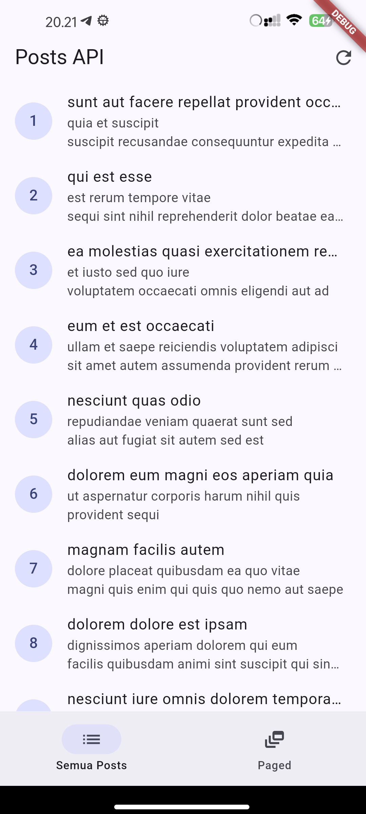
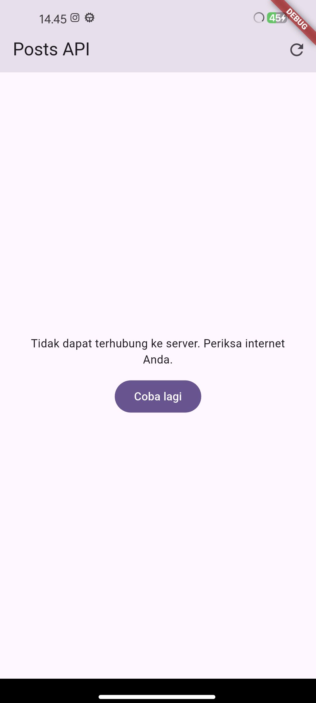
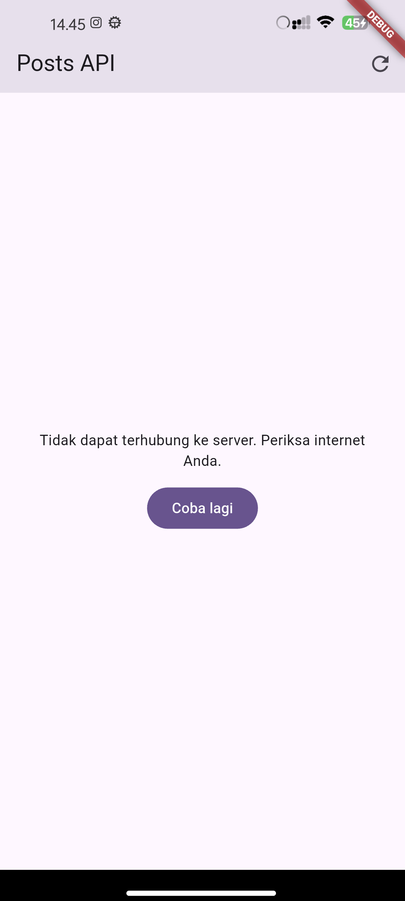
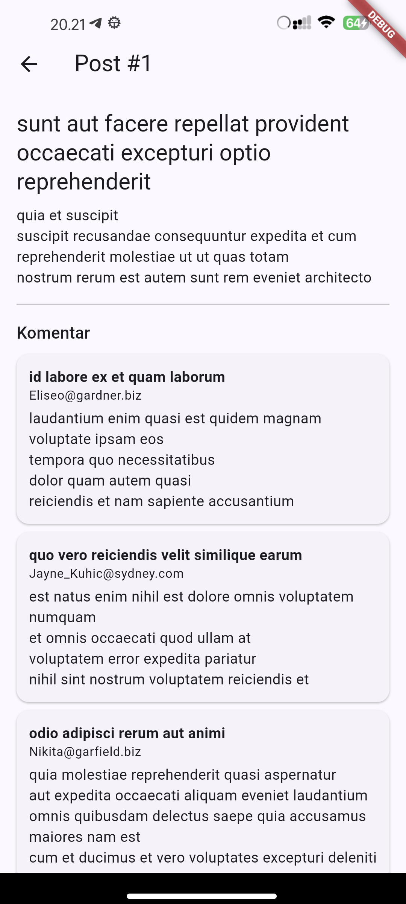
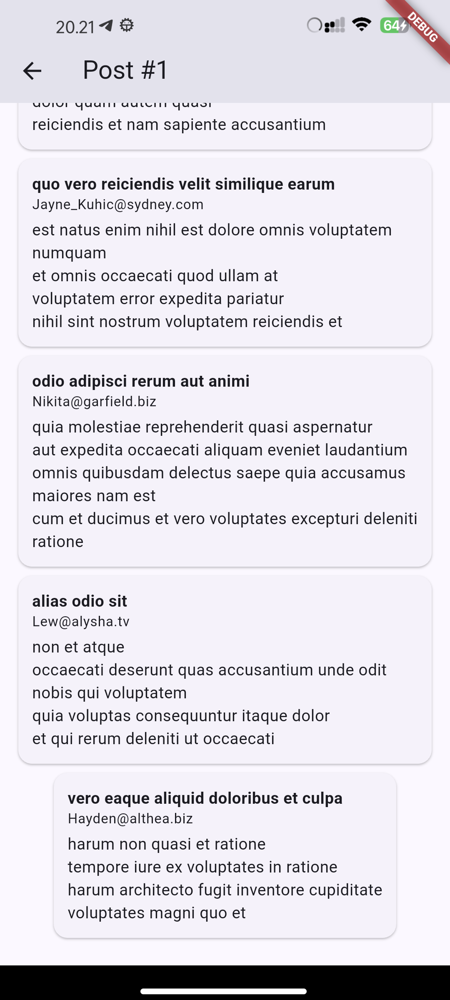
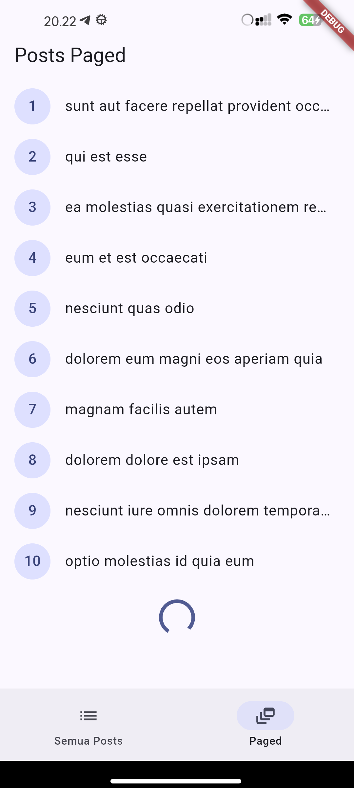
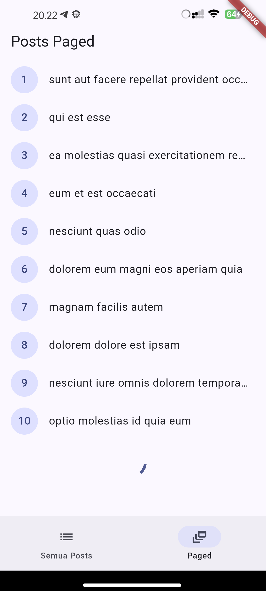
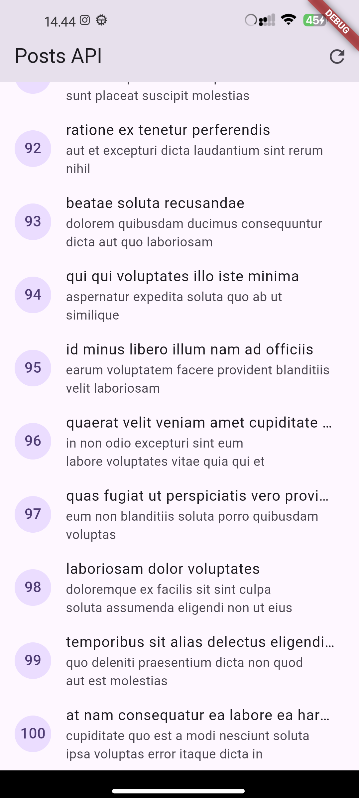
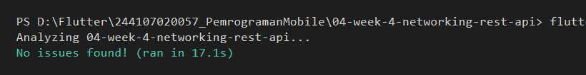
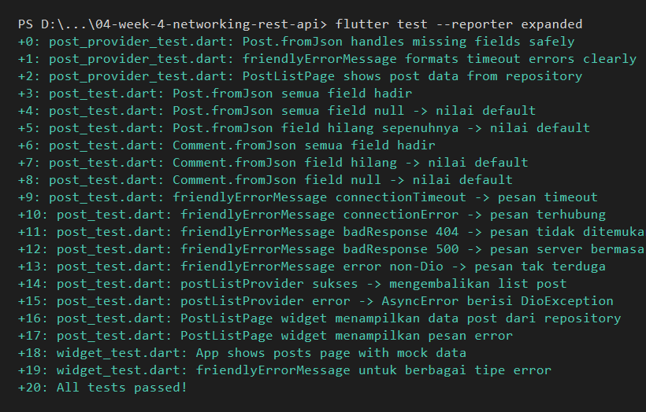

# Minggu 4 - Networking & REST API

| | |
|---|---|
| **Nama** | Rani Miftahus Saadah |
| **NIM** | 244107020057 |
| **Kelas** | TI_3F |
| **Mata Kuliah** | Pemrograman Mobile |
| **Program Studi** | Teknik Informatika, Politeknik Negeri Malang |

## 1. Tujuan

Membangun aplikasi **Posts API** yang:

- mengambil data dari REST API (JSONPlaceholder) melalui Dio,
- menerapkan **repository pattern** sehingga UI tidak memanggil Dio secara langsung,
- menampilkan keempat state: **loading, error, empty, success**,
- menyediakan **pagination infinite scroll** (10 item per halaman),
- menampilkan **halaman detail** post beserta daftar komentarnya,
- memiliki unit test model, mapping error, dan provider dengan repository palsu.

## 2. Fitur Utama

- **Tab Semua Posts** — daftar 100 posts dari `GET /posts`; tap item membuka detail.
- **Tab Paged** — infinite scroll, 10 item per halaman (`GET /posts?_page=N&_limit=10`), guard request ganda, indikator akhir data.
- **Halaman Detail Post** — menampilkan `title` + `body` lengkap, diikuti daftar komentar dari `GET /comments?postId={id}`.
- **Error handling** — pesan ramah pengguna untuk timeout, connection error, 404, 401/403, 5xx; tombol **Coba lagi** di setiap halaman.
- **Pull-to-refresh** — `RefreshIndicator` pada daftar utama.
- **AI Prompt Challenge** — `Comment` model + `CommentRepository` + `commentListProvider` (family).

## 3. Stack Teknologi

- Flutter (Material 3) dan Dart
- `dio` ^5.8.0 — HTTP client terpusat (base URL, timeout, LogInterceptor)
- `flutter_riverpod` ^3.4.3 — state management (`AsyncNotifier`, `Notifier`, family provider)
- `go_router` ^18.1.4 — routing (siap untuk navigasi lanjutan)
- Testing: `flutter_test`
- API: [JSONPlaceholder](https://jsonplaceholder.typicode.com)
- Perangkat uji: Android M2101K7BNY

## 4. Arsitektur

```
UI (ConsumerWidget)
  └─ ref.watch(provider)
        └─ AsyncNotifier / Notifier
              └─ Repository
                    └─ Dio ──► REST API
```

Aturan yang diterapkan:
- UI **tidak boleh** memanggil Dio langsung.
- Repository adalah satu-satunya pintu ke sumber data.
- `friendlyErrorMessage` terpusat di `lib/data/network_errors.dart`.

## 5. Struktur Folder

```
lib/
├── main.dart                      # ProviderScope + NavigationBar (tab Semua/Paged)
├── data/
│   ├── api_client.dart            # Dio terpusat (baseUrl, timeout, interceptor)
│   ├── network_errors.dart        # friendlyErrorMessage (dipakai semua halaman)
│   ├── providers.dart             # dioProvider, postRepositoryProvider, postListProvider
│   ├── paged_posts.dart           # PagedPostsState + PagedPostsNotifier
│   ├── comment_providers.dart     # commentRepositoryProvider, commentListProvider (family)
│   ├── models/
│   │   ├── post.dart              # Model Post dengan fromJson aman null
│   │   └── comment.dart          # Model Comment dengan fromJson aman null
│   └── repositories/
│       ├── post_repository.dart   # fetchPosts() + fetchPostsPage()
│       └── comment_repository.dart# fetchComments(postId)
├── pages/
│   ├── post_list_page.dart        # Tab Semua Posts (loading/error/empty/success)
│   ├── paged_post_page.dart       # Tab Paged (infinite scroll)
│   └── post_detail_page.dart     # Detail post + daftar komentar
└── widgets/
    └── post_tile.dart             # Widget baris post yang reusable
```

## 6. Hasil Praktikum

### 6.1 Praktikum 1: Model & Dio

Model `Post` memetakan JSON ke Dart dengan cast defensif (`as num? ?? 0`, `as String? ?? ''`) sehingga field hilang atau null tidak menyebabkan crash.

Dio dikonfigurasi terpusat di `api_client.dart`:

```dart
Dio createDio() {
  final dio = Dio(BaseOptions(
    baseUrl: 'https://jsonplaceholder.typicode.com',
    connectTimeout: const Duration(seconds: 10),
    receiveTimeout: const Duration(seconds: 10),
    headers: {'Accept': 'application/json'},
  ));
  dio.interceptors.add(LogInterceptor(requestBody: true, responseBody: false));
  return dio;
}
```

### 6.2 Praktikum 2: Repository & Provider

`PostRepository` adalah satu-satunya kelas yang memanggil Dio. Exception dibiarkan naik agar `AsyncNotifier` menangkap dan mengubahnya menjadi `AsyncError` secara otomatis.

```dart
// fetchPosts: semua data sekaligus
// fetchPostsPage: pagination ?_page=N&_limit=10
```

`postListProvider` memakai `retry: (_, __) => null` agar error langsung final dan mudah diuji (tanpa retry otomatis yang menggantung test).

### 6.3 Empat State UI

| State | Pemicu | Tampilan |
|---|---|---|
| Loading | Pertama kali buka / refresh | `CircularProgressIndicator` di tengah |
| Error | Tidak ada internet / URL salah | Pesan ramah + tombol **Coba lagi** |
| Empty | API mengembalikan list kosong | Teks "Belum ada data dari server." |
| Success | Data berhasil dimuat | `ListView` dengan `PostTile` |

| Loading | Success | Error + Coba lagi |
|---|---|---|
|  |  |  |

### 6.4 Pull-to-Refresh

`RefreshIndicator` membungkus `ListView`. Saat ditarik, `ref.read(postListProvider.notifier).refresh()` dipanggil — state menjadi `AsyncLoading`, data lama diganti, lalu `AsyncData` baru ditampilkan.



### 6.5 Halaman Detail Post + Komentar

Tap salah satu item membuka `PostDetailPage` yang menampilkan `title` dan `body` penuh, diikuti daftar komentar dari `GET /comments?postId={id}` via `commentListProvider(post.id)`.

| Detail Post | Komentar |
|---|---|
|  |  |

### 6.6 Pagination Infinite Scroll

Tab **Paged** memuat 10 item per halaman. `ScrollController` memicu `loadNextPage()` saat pengguna 200px dari ujung list. Guard `if (state.isLoadingMore || !state.hasMore) return;` mencegah request ganda. Saat halaman terakhir dimuat, indikator berganti menjadi teks "Semua data termuat."

| Halaman 1 | Scroll (halaman 2) | Semua termuat |
|---|---|---|
|  |  |  |

## 7. AI Prompt Challenge

Lihat dokumentasi lengkap di [`docs/ai_challenge.md`](docs/ai_challenge.md).

**Prompt:**

```
Buatkan repository layer Flutter untuk endpoint GET /comments?postId={id}
dari JSONPlaceholder menggunakan Dio + flutter_riverpod.
Requirements:
- Model Comment dengan fromJson aman null (postId, id, name, email, body).
- CommentRepository dengan method fetchComments(postId) + timeout 10 detik.
- AsyncNotifierProvider dengan penanganan error otomatis (AsyncError)
  dan fungsi pesan error ramah pengguna untuk timeout, connection error, 404, dan 500.
- Satu unit test untuk fromJson dengan field yang hilang.
Jelaskan setiap bagian kode dalam komentar.
```

**Verifikasi checklist:**

| Pemeriksaan | Hasil | Catatan |
|---|---|---|
| UI memanggil Dio langsung? | ❌ Tidak | Semua akses via `commentRepositoryProvider` |
| `fromJson` aman null? | ✅ Ya | Pola `(json['x'] as num?)?.toInt() ?? 0` |
| Semua tipe `DioExceptionType` dipetakan? | ✅ Ya | timeout, connectionError, badResponse (404/401/403/5xx) |
| `baseUrl`/timeout terpusat? | ✅ Ya | Di `api_client.dart`, tidak per-method |
| Test menguji field hilang? | ✅ Ya | 3 kasus: semua hadir, semua null, field tidak ada |
| `flutter analyze` lolos? | ✅ Ya | No issues found |
| `flutter test` lolos? | ✅ Ya | All tests passed |

**Temuan & perbaikan:**

| # | Masalah dari AI | Perbaikan |
|---|---|---|
| 1 | Cast langsung `json['postId'] as int` (crash jika null) | Diganti pola aman null `(json['postId'] as num?)?.toInt() ?? 0` |
| 2 | `FutureProvider.family` bukan `AsyncNotifierProvider.family` | Diubah ke `AsyncNotifierProvider.family` agar konsisten |
| 3 | `friendlyErrorMessage` tidak menangani `connectionError` & `sendTimeout` | Ditambahkan kedua case; dipindahkan ke `network_errors.dart` |
| 4 | Test hanya happy path | Ditambahkan: field hilang, field null, error connection |


| # | Perubahan | Sebelum | Sesudah |
|---|---|---|---|
| 1 | Baris post menjadi widget reusable | Kode inline di `ListView.builder` | `PostTile(post, onTap)` di `lib/widgets/post_tile.dart` |
| 2 | `friendlyErrorMessage` terpusat | Di `providers.dart` | `lib/data/network_errors.dart` (diimpor semua halaman) |
| 3 | Halaman detail post | Belum ada | `PostDetailPage` + komentar dari `commentListProvider(id)` |
| 4 | Navigasi detail | Belum ada | `Navigator.push` → `PostDetailPage` |

## 9. Pengujian

| Test | File | Yang diverifikasi | Hasil |
|---|---|---|---|
| `Post.fromJson` semua field hadir | `post_test.dart` | Nilai field terpetakan benar | Lulus |
| `Post.fromJson` semua null | `post_test.dart` | Nilai default (0, '') | Lulus |
| `Post.fromJson` field tidak ada | `post_test.dart` | `id=7`, sisanya default | Lulus |
| `Comment.fromJson` semua field | `post_test.dart` | Nilai terpetakan | Lulus |
| `Comment.fromJson` field hilang | `post_test.dart` | Nilai default | Lulus |
| `Comment.fromJson` semua null | `post_test.dart` | Nilai default | Lulus |
| `friendlyErrorMessage` connectionTimeout | `post_test.dart` | Pesan mengandung 'timeout' | Lulus |
| `friendlyErrorMessage` connectionError | `post_test.dart` | Pesan mengandung 'terhubung' | Lulus |
| `friendlyErrorMessage` 404 | `post_test.dart` | Pesan mengandung '404' | Lulus |
| `friendlyErrorMessage` 500 | `post_test.dart` | Pesan mengandung '500' | Lulus |
| `friendlyErrorMessage` non-Dio | `post_test.dart` | Pesan mengandung 'tak terduga' | Lulus |
| Provider sukses (fake repository) | `post_test.dart` | List berisi 1 post | Lulus |
| Provider error (fake repository) | `post_test.dart` | Error bertipe `DioException` | Lulus |
| Widget: tampilkan data | `post_test.dart` | Judul & isi muncul di UI | Lulus |
| Widget: tampilkan error | `post_test.dart` | Tombol "Coba lagi" muncul | Lulus |
| Widget: app + mock data | `widget_test.dart` | AppBar + data tampil | Lulus |
| `friendlyErrorMessage` timeout/conn | `widget_test.dart` | Pesan benar | Lulus |
| `fromJson` null handling | `post_provider_test.dart` | Nilai default | Lulus |
| `friendlyErrorMessage` timeout | `post_provider_test.dart` | Pesan timeout | Lulus |
| Widget: data dari repository | `post_provider_test.dart` | Data tampil | Lulus |

| `flutter analyze` | `flutter test` |
|---|---|
|  |  |

## 10. Refleksi

**Mengapa UI dilarang memanggil Dio langsung? Apa yang rusak jika dilanggar?**
Jika widget memanggil Dio langsung, testing menjadi mustahil tanpa HTTP sungguhan, logika error tersebar di banyak widget, dan mengganti library jaringan membutuhkan perubahan di setiap halaman. Repository memisahkan concern sehingga UI hanya membaca `AsyncValue` dan tidak peduli sumber datanya.

**Kapan pagination client-side cukup, dan kapan harus server-side?**
Client-side (memuat semua data lalu memotong) cukup jika data kecil (ratusan item, ukuran total < 1MB). Ketika data besar (ribuan item, gambar), server-side pagination (`_page`/`_limit`) wajib dipakai agar tidak membuang bandwidth dan memori perangkat.

**Bagaimana exception repository berubah menjadi `AsyncError` tanpa try/catch di setiap widget?**
`AsyncNotifier.build()` yang memanggil `repository.fetchPosts()` tanpa try/catch — Riverpod menangkap exception yang lolos dan secara otomatis mengubahnya menjadi `AsyncError`. Widget cukup menggunakan `.when(error: ...)` untuk menampilkan UI error tanpa try/catch tambahan.

**Bagian mana dari hasil AI yang diperbaiki?**
Cast `fromJson` yang tidak aman null diganti pola defensif. `FutureProvider.family` diubah ke `AsyncNotifierProvider.family`. `friendlyErrorMessage` diperlengkapi dengan `connectionError` dan `sendTimeout`, lalu dipindahkan ke file terpisah agar bisa dipakai ulang. Test juga diperluas dari satu happy path menjadi 3 kasus (hadir, null, hilang).

## 11. Kesimpulan

Pada minggu ini saya membangun aplikasi yang mengambil data dari REST API menggunakan Dio + Riverpod dengan repository pattern. Praktikum ini memperjelas pentingnya memisahkan layer data dari UI, cara kerja `AsyncValue` dalam memodelkan loading/error/success, dan bagaimana pagination dengan guard request ganda mencegah duplikasi request. AI Challenge membantu merancang `Comment` layer, namun perbaikan signifikan pada null-safety cast, cakupan error, dan struktur provider tetap diperlukan.
