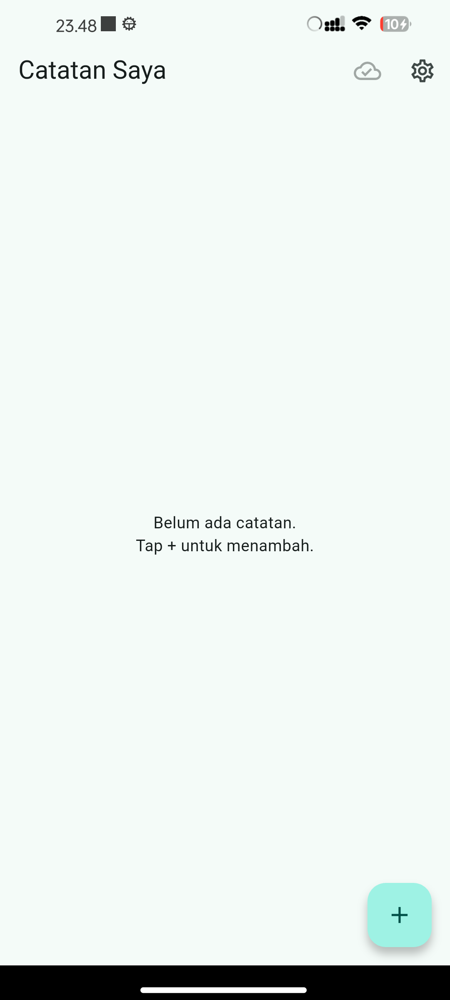
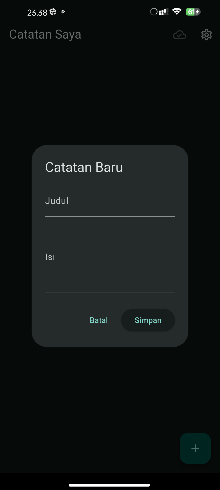
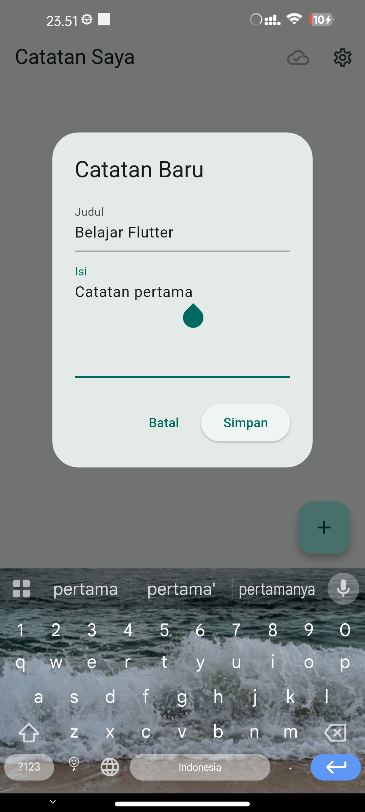
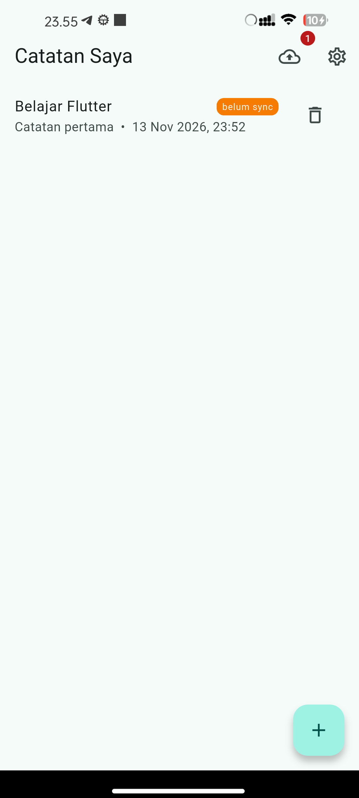
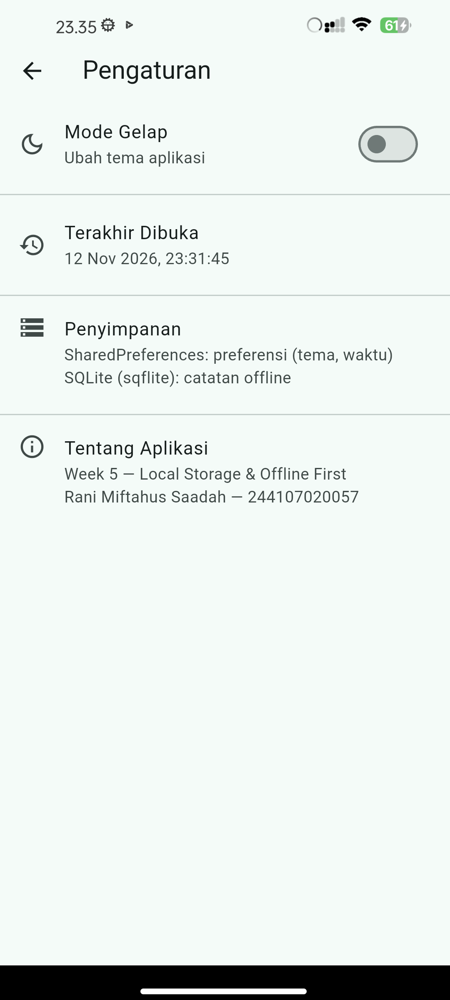
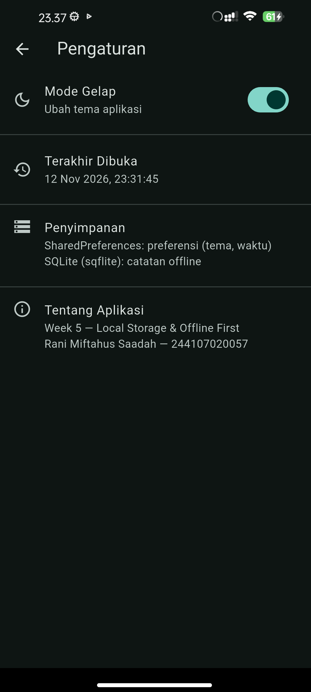
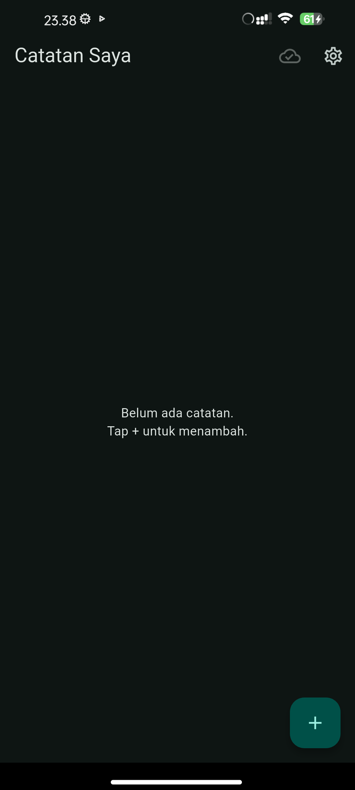
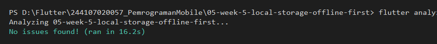
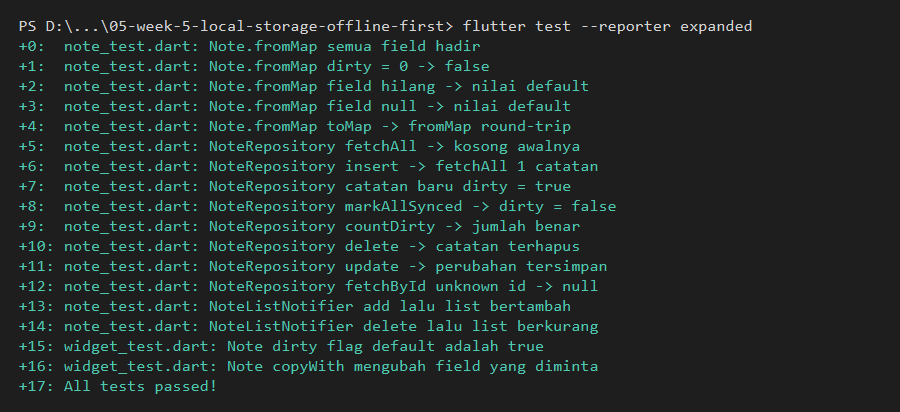

# Minggu 5 - Local Storage & Offline First

| | |
|---|---|
| **Nama** | Rani Miftahus Saadah |
| **NIM** | 244107020057 |
| **Kelas** | TI_3F |
| **Mata Kuliah** | Pemrograman Mobile |
| **Program Studi** | Teknik Informatika, Politeknik Negeri Malang |

## 1. Tujuan

Membangun aplikasi **Offline Notes** yang berjalan penuh tanpa koneksi internet, menggunakan SQLite (`sqflite`) untuk penyimpanan catatan dengan *dirty flag* dan *last-write-wins sync*, serta SharedPreferences untuk preferensi pengguna (tema gelap/terang, waktu terakhir dibuka).

## 2. Fitur Utama

- **SharedPreferences:** simpan/baca preferensi tema gelap dan waktu terakhir buka halaman Settings secara persisten.
- **SQLite CRUD:** tambah, baca, ubah, dan hapus catatan menggunakan `NoteRepository` berbasis sqflite.
- **Dirty Flag:** setiap catatan baru atau yang diedit ditandai `dirty=1`; badge di AppBar menampilkan jumlah catatan belum tersync.
- **Simulasi Sync:** tombol upload mensimulasikan pengiriman ke server lalu memanggil `markAllSynced()` → semua `dirty` menjadi 0.
- **GoRouter:** navigasi `/` (daftar catatan), `/note/:id` (detail/edit), `/settings` (pengaturan).
- **Offline First:** tidak ada koneksi internet yang dibutuhkan; app berjalan penuh dari database lokal.
- **Testing:** 14 test (unit model, repository in-memory, provider) tanpa HTTP sungguhan.

## 3. Stack Teknologi

- Flutter dan Dart
- `flutter_riverpod` ^2.6.1 — state management (`AsyncNotifier`, `FutureProvider`)
- `sqflite` ^2.4.2 — database SQLite lokal
- `shared_preferences` ^2.3.5 — penyimpanan key-value
- `go_router` ^14.8.1 — navigasi deklaratif
- `intl` ^0.19.0 — format tanggal/waktu
- `sqflite_common_ffi` ^2.3.4 — in-memory SQLite untuk pengujian
- Perangkat uji: Android M2101K7BNY (Redmi Note 10)

## 4. Arsitektur

```
UI (ConsumerWidget / ConsumerStatefulWidget)
  └─ ref.watch(provider)
        ├─ NoteListNotifier  →  NoteRepository  →  SQLite (notes.db)
        ├─ DarkModeNotifier  →  PrefsRepository →  SharedPreferences
        ├─ SyncNotifier      →  NoteRepository  →  markAllSynced()
        ├─ dirtyCountProvider →  countDirty()
        └─ lastOpenedProvider →  updateLastOpened()
```

**Prinsip:**
- UI tidak pernah menyentuh SQLite atau SharedPreferences langsung
- Repository menerima `DbOpener` (function) → mudah diganti in-memory untuk test
- `NoteListNotifier.invalidateSelf()` memastikan UI selalu sinkron setelah mutasi

## 5. Struktur Proyek

```
05-week-5-local-storage-offline-first/
├── lib/
│   ├── main.dart                        # App + GoRouter setup
│   ├── data/
│   │   ├── local/
│   │   │   ├── db.dart                  # openNotesDb() → SQLite
│   │   │   └── note.dart                # Model Note + dirty flag
│   │   ├── prefs.dart                   # PrefsRepository (SharedPreferences)
│   │   ├── providers.dart               # Semua provider Riverpod
│   │   └── repositories/
│   │       └── note_repository.dart     # CRUD + countDirty + markAllSynced
│   ├── pages/
│   │   ├── notes_page.dart              # Daftar catatan + badge + sync
│   │   ├── note_detail_page.dart        # Edit judul/isi + dirty indicator
│   │   └── settings_page.dart           # Toggle tema + last opened
│   └── widgets/
│       └── note_tile.dart               # NoteTile dengan badge "belum sync"
├── test/
│   └── note_test.dart                   # 14 unit + provider test
├── docs/
│   └── ai_challenge.md                  # Tabel perbandingan storage + prompt
├── Screenshots/
└── README.md
```

## 6. Praktikum

### Praktikum 1 — SharedPreferences (Preferensi Tema)

`PrefsRepository` membungkus `SharedPreferences` dengan dua operasi:
- `getDarkMode()` / `setDarkMode(bool)` → kunci `dark_mode`
- `getLastOpened()` / `updateLastOpened()` → kunci `last_opened_at`

`DarkModeNotifier` membaca nilai awal dari SharedPreferences saat `build()` dan memanggil `setDarkMode()` pada setiap toggle, kemudian mengupdate `state` agar UI langsung reaktif.

```dart
class DarkModeNotifier extends AsyncNotifier<bool> {
  @override
  Future<bool> build() => ref.read(prefsRepositoryProvider).getDarkMode();

  Future<void> toggle() async {
    final current = state.value ?? false;
    await ref.read(prefsRepositoryProvider).setDarkMode(!current);
    state = AsyncData(!current);
  }
}
```

| Preferensi | Kunci | Tipe |
|---|---|---|
| Tema gelap | `dark_mode` | `bool` |
| Waktu terakhir buka | `last_opened_at` | `String` (ISO 8601) |

### Praktikum 2 — SQLite CRUD (NoteRepository)

Tabel `notes` di `notes.db`:

```sql
CREATE TABLE notes (
  id         INTEGER PRIMARY KEY AUTOINCREMENT,
  title      TEXT    NOT NULL DEFAULT '',
  body       TEXT    NOT NULL DEFAULT '',
  dirty      INTEGER NOT NULL DEFAULT 1,
  updated_at TEXT    NOT NULL
)
```

`NoteRepository` menerima `DbOpener` (typedef `Future<Database> Function()`) sehingga test dapat menyuntikkan in-memory database:

```dart
class NoteRepository {
  NoteRepository(this._openDb);
  final DbOpener _openDb;
  ...
  Future<int> countDirty() async { ... WHERE dirty = 1 }
  Future<void> markAllSynced() async { UPDATE notes SET dirty = 0 }
}
```

### Praktikum 3 — Dirty Flag & Sync

Setiap catatan baru atau yang diedit mendapat `dirty=1`. `SyncNotifier` mensimulasikan upload ke server dengan `Future.delayed(1 detik)` lalu memanggil `markAllSynced()`.

```dart
Future<void> sync() async {
  state = const AsyncLoading();
  state = await AsyncValue.guard(() async {
    final dirty = await repo.countDirty();
    await Future.delayed(const Duration(seconds: 1)); // simulasi upload
    await repo.markAllSynced();
    ref.invalidate(noteListProvider);
    return 'Berhasil sync $dirty catatan';
  });
}
```

### Praktikum 4 — Offline First

App membaca dari SQLite setiap kali dibuka — tidak ada panggilan HTTP di startup. Koneksi internet hanya relevan saat "sync" (yang disimulasikan). App berfungsi penuh dalam mode pesawat.

### Praktikum 5 — Navigasi GoRouter

```dart
GoRoute(path: '/', builder: (_, __) => const NotesPage()),
GoRoute(path: '/note/:id', builder: (_, state) {
  final id = int.parse(state.pathParameters['id']!);
  return NoteDetailPage(noteId: id);
}),
GoRoute(path: '/settings', builder: (_, __) => const SettingsPage()),
```

## 7. Screenshot Aplikasi

### Halaman Utama & Dialog Tambah

| Kosong (pertama kali) | Dialog Tambah | Dialog Terisi | Daftar Catatan | Settings |
|---|---|---|---|---|
|  |  |  |  |  |

**Keterangan:**
- **Kosong** — empty state pertama kali buka app; pesan "Belum ada catatan. Tap + untuk menambah."
- **Dialog Tambah** — form tambah catatan dengan field Judul & Isi
- **Dialog Terisi** — judul "Belajar Flutter" + isi "Catatan pertama" siap disimpan
- **Daftar Catatan** — catatan tersimpan dengan badge **belum sync** (dirty flag), timestamp, dan upload icon badge `1`
- **Settings** — SharedPreferences: toggle Mode Gelap + info "Terakhir Dibuka" + info penyimpanan

### Tema Gelap

| Settings Dark Mode (aktif) | Dark Mode (kosong) |
|---|---|
|  |  |

## 8. Pengujian

### Daftar Test (`test/note_test.dart`)

| Test | File | Hasil |
|---|---|---|
| `Note.fromMap` semua field hadir | `note_test.dart` | Lulus |
| `Note.fromMap` dirty=0 → false | `note_test.dart` | Lulus |
| `Note.fromMap` field hilang → default | `note_test.dart` | Lulus |
| `Note.fromMap` field null → default | `note_test.dart` | Lulus |
| `toMap → fromMap` round-trip | `note_test.dart` | Lulus |
| fetchAll kosong awalnya | `note_test.dart` | Lulus |
| insert → fetchAll 1 catatan | `note_test.dart` | Lulus |
| catatan baru dirty = true | `note_test.dart` | Lulus |
| markAllSynced → dirty = false | `note_test.dart` | Lulus |
| countDirty → jumlah benar | `note_test.dart` | Lulus |
| delete → terhapus | `note_test.dart` | Lulus |
| update → perubahan tersimpan | `note_test.dart` | Lulus |
| fetchById unknown → null | `note_test.dart` | Lulus |
| NoteListNotifier add → bertambah | `note_test.dart` | Lulus |
| NoteListNotifier delete → berkurang | `note_test.dart` | Lulus |

| `flutter analyze` | `flutter test` |
|---|---|
|  |  |

## 9. AI Prompt Challenge

Lihat [`docs/ai_challenge.md`](docs/ai_challenge.md) untuk:
- Prompt yang digunakan
- Tabel perbandingan SharedPreferences vs Hive vs SQLite vs Drift
- Rekomendasi kombinasi untuk kasus offline-first
- Perbaikan yang dilakukan pada output AI

**Kesimpulan:** Kombinasi **SharedPreferences** (preferensi) + **SQLite/sqflite** (data terstruktur) adalah yang paling sesuai untuk aplikasi offline-first dengan dirty flag dan sync queue.

## 10. Refleksi

**Mengapa dirty flag lebih baik dari "selalu sync saat ada koneksi"?**  
Dirty flag memisahkan kapan data dibuat/diubah dari kapan data dikirim ke server. Ini memungkinkan batch sync (satu request untuk banyak perubahan), conflict resolution (`updated_at` untuk last-write-wins), dan retry yang aman jika sync gagal tanpa kehilangan data.

**Mengapa `NoteRepository` menerima `DbOpener` alih-alih membuka database sendiri?**  
Dependency injection via constructor — test dapat menyuntikkan `inMemoryDatabasePath` tanpa menyentuh disk. Ini membuat test deterministik, cepat, dan tidak meninggalkan file sisa.

**Kapan memilih Drift daripada sqflite?**  
Drift lebih cocok ketika: (1) schema punya banyak tabel dengan relasi kompleks, (2) butuh type-safe query tanpa menulis SQL manual, (3) tim besar yang perlu auto-migration saat schema berubah. Untuk CRUD sederhana seperti notes app ini, sqflite lebih minimal dan mudah dipahami.
