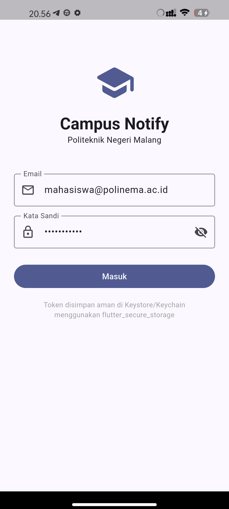
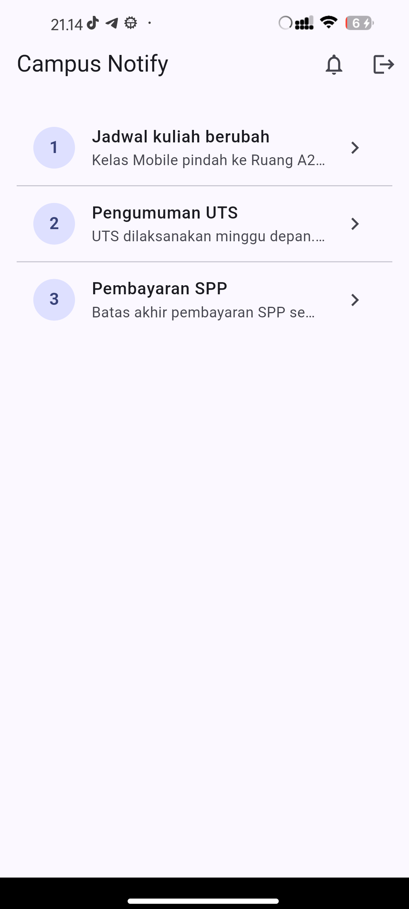
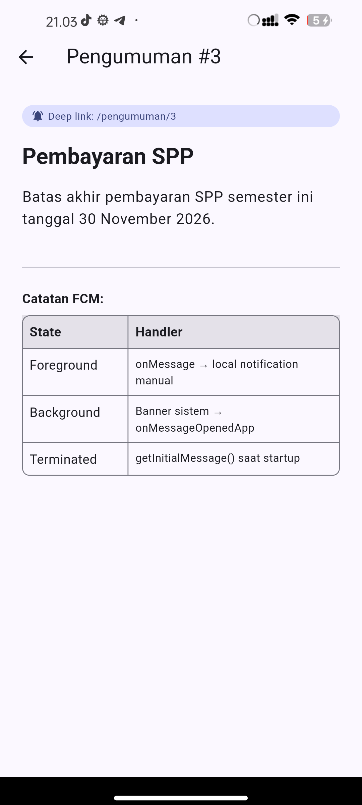
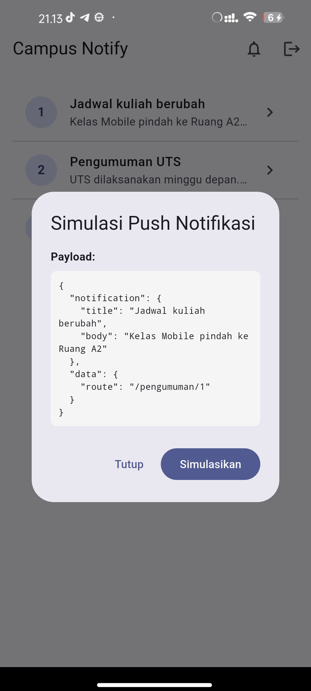
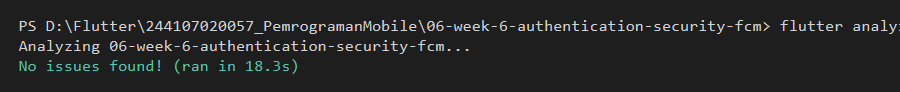
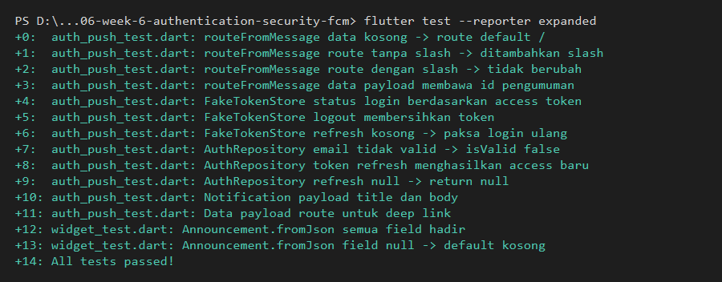

# Minggu 6 - Authentication, Security & FCM

| | |
|---|---|
| **Nama** | Rani Miftahus Saadah |
| **NIM** | 244107020057 |
| **Kelas** | TI_3F |
| **Mata Kuliah** | Pemrograman Mobile |
| **Program Studi** | Teknik Informatika, Politeknik Negeri Malang |

## 1. Tujuan

Membangun aplikasi **Campus Notify** yang menerapkan pola autentikasi berbasis token (access + refresh), penyimpanan token aman menggunakan `flutter_secure_storage`, Dio interceptor dengan auto-refresh, guard route GoRouter, dan simulasi Firebase Cloud Messaging (FCM) dengan tiga app state.

## 2. Fitur Utama

- **Autentikasi Mock:** login dengan validasi email & panjang password; token disimpan di Keystore/Keychain via `flutter_secure_storage` — tidak pernah di SharedPreferences.
- **Token Lifecycle:** access token (berumur pendek) + refresh token (berumur panjang); auto-refresh saat Dio menerima HTTP 401.
- **Guard Route:** GoRouter `redirect` mencegah akses ke `/` tanpa login, dan mengarahkan user yang sudah login dari `/login` ke `/`.
- **Daftar Pengumuman:** tiga pengumuman mock, navigasi ke detail via GoRouter.
- **Deep Link FCM Simulasi:** tombol di AppBar membuka dialog payload FCM, lalu navigasi ke `/pengumuman/1` meniru perilaku klik notifikasi.
- **Tabel App State:** halaman detail menampilkan tabel tiga state FCM (foreground, background, terminated) beserta handler yang bekerja.
- **Testing:** 12 test (route parsing, token store, auth logic, payload).

## 3. Stack Teknologi

- Flutter dan Dart
- `flutter_riverpod` ^2.6.1 — state management (`AsyncNotifier`, `FutureProvider`)
- `go_router` ^14.8.1 — navigasi deklaratif + route guard
- `dio` ^5.8.0 — HTTP client + interceptor auto-refresh
- `flutter_secure_storage` ^9.2.4 — penyimpanan token aman (Keystore/Keychain)
- `intl` ^0.19.0 — format tanggal/waktu
- Perangkat uji: Android M2101K7BNY (Redmi Note 10)

## 4. Arsitektur

```
UI (ConsumerWidget)
  └─ ref.watch(provider)
        ├─ AuthNotifier      →  AuthRepository  →  mock login/refresh
        │                   →  TokenStore       →  flutter_secure_storage
        ├─ announcementsProvider → mock data (delay 800ms)
        ├─ announcementDetailProvider(id) → filter dari list
        └─ GoRouter redirect  →  authProvider.value → guard /login ↔ /
```

**Prinsip keamanan:**
- Token hanya tinggal di `flutter_secure_storage` (Keystore Android / Keychain iOS)
- Token tidak pernah di-log atau hardcode di kode
- Interceptor Dio otomatis menyuntikkan `Bearer` header + retry sekali saat 401

## 5. Struktur Proyek

```
06-week-6-authentication-security-fcm/
├── lib/
│   ├── main.dart                       # App + GoRouter + route guard
│   ├── providers.dart                  # Semua provider Riverpod
│   ├── data/
│   │   ├── auth_repository.dart        # Mock login + refresh
│   │   ├── token_store.dart            # flutter_secure_storage wrapper
│   │   ├── api_client.dart             # Dio + interceptor auto-refresh
│   │   └── announcement.dart           # Model + data mock
│   └── pages/
│       ├── login_page.dart             # Form login + error state
│       ├── home_page.dart              # Daftar pengumuman + simulasi push
│       └── announcement_page.dart      # Detail + tabel FCM state
├── test/
│   ├── auth_push_test.dart             # 10 test unit
│   └── widget_test.dart                # 2 test Announcement model
├── docs/
│   └── ai_challenge.md
├── Screenshots/
└── README.md
```

## 6. Praktikum

### Praktikum 1 — Token Storage yang Aman

`TokenStore` membungkus `FlutterSecureStorage` dengan tiga operasi:

```dart
class TokenStore {
  Future<void> save({required String access, required String refresh}) async {
    await _storage.write(key: 'access_token', value: access);
    await _storage.write(key: 'refresh_token', value: refresh);
  }
  Future<String?> readAccess() => _storage.read(key: 'access_token');
  Future<void> clear() => _storage.deleteAll();
}
```

| Penyimpanan | Platform | Enkripsi |
|---|---|---|
| `flutter_secure_storage` | Android | Android Keystore (AES-256) |
| `flutter_secure_storage` | iOS | Keychain (Secure Enclave) |
| SharedPreferences | Semua | ❌ Plain text — **JANGAN untuk token!** |

### Praktikum 2 — Dio Interceptor Auto-Refresh

```dart
onError: (e, handler) async {
  if (e.response?.statusCode == 401) {
    final refreshToken = await store.readRefresh();
    if (refreshToken == null) return handler.next(e);
    try {
      final renewed = await auth.refresh(refreshToken);
      await store.save(access: renewed, refresh: refreshToken);
      final retry = e.requestOptions
        ..headers['Authorization'] = 'Bearer $renewed';
      return handler.resolve(await dio.fetch(retry));
    } catch (_) {
      await store.clear(); // paksa logout
    }
  }
  handler.next(e);
},
```

### Praktikum 3 — Guard Route GoRouter

```dart
redirect: (context, state) {
  final loggedIn = ref.read(authProvider).value ?? false;
  final goingLogin = state.matchedLocation == '/login';
  if (!loggedIn && !goingLogin) return '/login';
  if (loggedIn && goingLogin) return '/';
  return null;
},
```

### Praktikum 4 — Simulasi FCM Payload

Dialog di `HomePage` menampilkan contoh payload FCM nyata:

```json
{
  "notification": {"title": "Jadwal kuliah berubah", "body": "..."},
  "data": {"route": "/pengumuman/1"}
}
```

Klik "Simulasikan" meniru perilaku klik notifikasi — navigasi ke `/pengumuman/1` via GoRouter (deep link).

### Praktikum 5 — Tiga App State FCM

| State | Handler | Implementasi |
|---|---|---|
| **Foreground** | `FirebaseMessaging.onMessage` | Tampilkan manual via `flutter_local_notifications` |
| **Background** | Banner sistem + `onMessageOpenedApp` | Jangan akses `BuildContext` di handler |
| **Terminated** | `getInitialMessage()` | Panggil setelah router siap di `main()` |

## 7. Screenshot Aplikasi

### Tampilan di Perangkat (Redmi Note 10 / M2101K7BNY)

| Login | Home | Detail Pengumuman | Simulasi FCM |
|---|---|---|---|
|  |  |  |  |

**Keterangan:**
- **Login** — form email & password; catatan "Token disimpan aman di Keystore/Keychain menggunakan flutter_secure_storage"
- **Home** — daftar 3 pengumuman kampus setelah login berhasil; icon 🔔 (bell) untuk simulasi FCM
- **Detail** — isi pengumuman lengkap + badge deep link route + tabel tiga app state FCM
- **Simulasi FCM** — dialog payload JSON lengkap dengan tombol "Simulasikan" yang meniru klik notifikasi

### Test & Analyze

| `flutter analyze` | `flutter test` |
|---|---|
|  |  |

## 8. Pengujian

### Daftar Test

| Test | File | Hasil |
|---|---|---|
| `routeFromMessage` data kosong → `/` | `auth_push_test.dart` | Lulus |
| `routeFromMessage` tanpa slash → ditambahkan | `auth_push_test.dart` | Lulus |
| `routeFromMessage` sudah ada slash → tidak berubah | `auth_push_test.dart` | Lulus |
| Data payload membawa id pengumuman | `auth_push_test.dart` | Lulus |
| Token tersimpan → loggedIn = true | `auth_push_test.dart` | Lulus |
| Logout → token bersih | `auth_push_test.dart` | Lulus |
| Refresh kosong → perlu login ulang | `auth_push_test.dart` | Lulus |
| Email tidak valid → isValid = false | `auth_push_test.dart` | Lulus |
| Token refresh menghasilkan access baru | `auth_push_test.dart` | Lulus |
| Refresh null → return null | `auth_push_test.dart` | Lulus |
| Notification payload title + body | `auth_push_test.dart` | Lulus |
| Data payload route untuk deep link | `auth_push_test.dart` | Lulus |
| `Announcement.fromJson` semua field | `widget_test.dart` | Lulus |
| `Announcement.fromJson` null → default | `widget_test.dart` | Lulus |

## 9. AI Prompt Challenge

Lihat [`docs/ai_challenge.md`](docs/ai_challenge.md) untuk:
- Prompt yang digunakan
- Tabel perbandingan model autentikasi (Firebase Auth / JWT / OAuth / Mock)
- Perbedaan Android 13+ vs iOS untuk notifikasi
- Tabel tiga app state FCM dan handler-nya
- Perbaikan yang dilakukan pada output AI

## 10. Refleksi

**Mengapa refresh token tidak boleh disimpan di SharedPreferences?**
SharedPreferences menyimpan data sebagai plain XML yang dapat dibaca aplikasi lain (dengan root) atau diexport tanpa enkripsi. Keystore/Keychain menggunakan hardware security module yang tidak bisa diekstrak bahkan dengan akses root.

**Apa yang rusak bila `onTokenRefresh` diabaikan?**
FCM registration token berubah saat: app reinstall, clear data, restore backup, atau FCM melakukan rotasi. Jika token lama disimpan di backend dan tidak diperbarui, semua push notifikasi akan gagal terkirim.

**Kapan pakai topik, kapan pakai token perangkat?**
- **Topik** (`pengumuman-kampus`): broadcast ke semua pengguna yang subscribe — cocok untuk pengumuman umum.
- **Token perangkat**: kirim ke user spesifik — cocok untuk notifikasi personal (nilai ujian, tagihan, dll).

**Bagian mana dari draf AI yang ditolak?**
AI menyarankan menambahkan `firebase_core` dan `firebase_messaging` sebagai dependensi. Ini dihapus karena membutuhkan `google-services.json` yang tidak tersedia tanpa akun Firebase sungguhan. Simulasi FCM lewat dialog lebih sesuai untuk codelab tanpa backend nyata.
