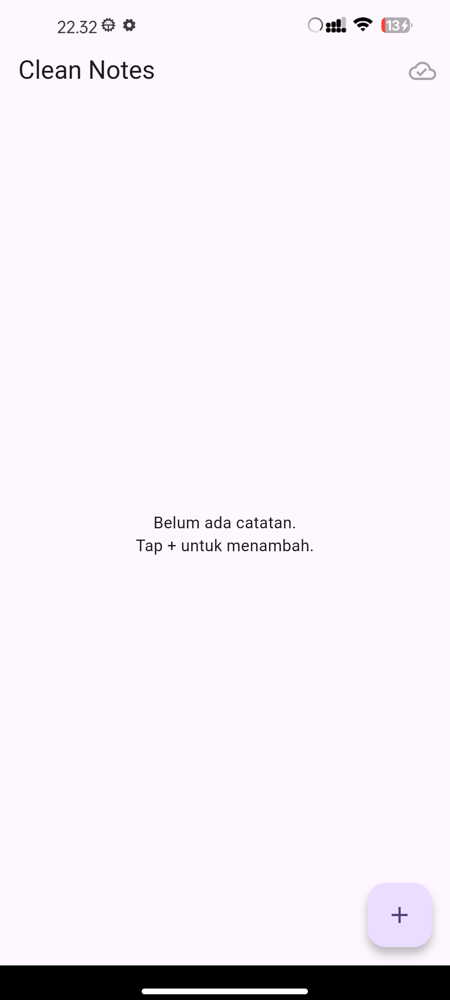
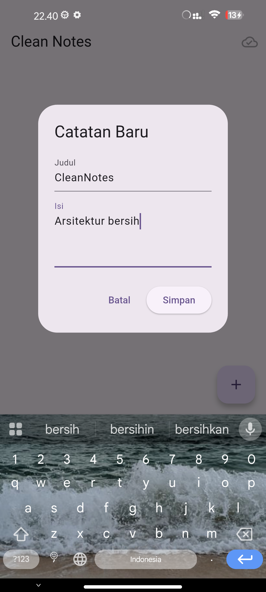
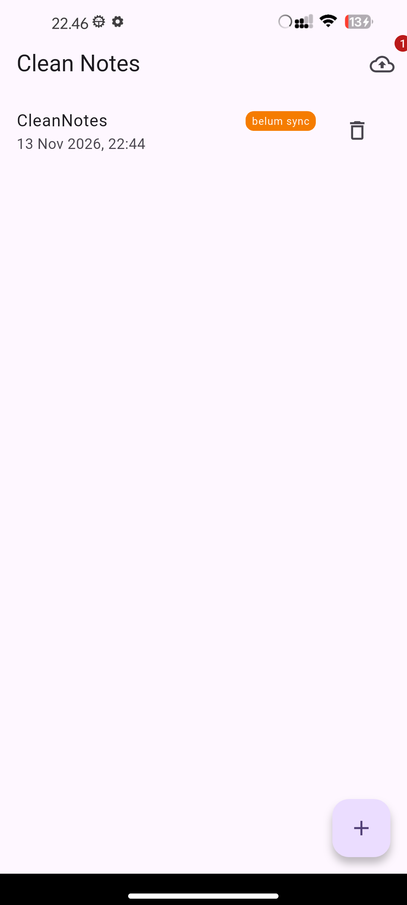
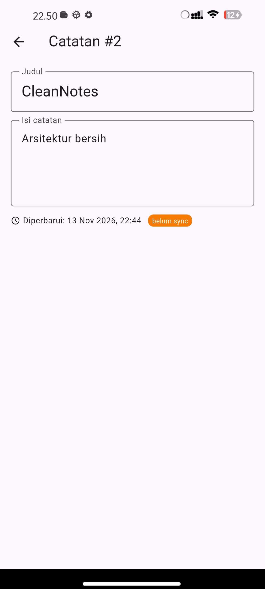
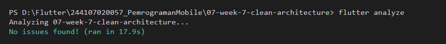
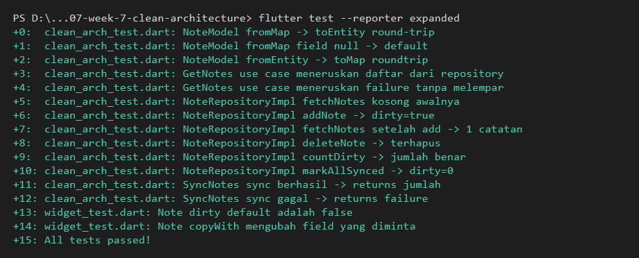

# Minggu 7 - Clean Architecture

| | |
|---|---|
| **Nama** | Rani Miftahus Saadah |
| **NIM** | 244107020057 |
| **Kelas** | TI_3F |
| **Mata Kuliah** | Pemrograman Mobile |
| **Program Studi** | Teknik Informatika, Politeknik Negeri Malang |

## 1. Tujuan

Merefactor project Minggu 5 (Offline Notes) menjadi **Clean Architecture feature-first** dengan tiga layer terpisah (presentation, domain, data), dependency rule yang terbukti lewat grep sterilitas, use case sebagai orkestrasi logika bisnis, dan entity murni yang bebas dari dependency framework.

## 2. Prinsip Utama

- **Dependency Rule:** dependensi hanya mengarah ke dalam — `presentation → domain ← data`
- **Entity vs Model:** entity murni di `domain` (tanpa `toMap`/`fromMap`); model mapping di `data`
- **Repository Interface di Domain:** kontrak ada di domain, implementasi di data
- **Use Case:** satu class per operasi bisnis — bukan satu class per CRUD satu baris
- **DI via Riverpod:** tidak ada `new Repository()` di widget; semua disuntik lewat provider

## 3. Struktur Proyek (Feature-First)

```
07-week-7-clean-architecture/
├── lib/
│   ├── main.dart
│   ├── core/
│   │   ├── failures.dart              # sealed Failure (LocalFailure, NetworkFailure)
│   │   └── providers.dart             # Riverpod DI wiring
│   └── features/
│       └── notes/
│           ├── domain/                # Tidak mengimpor flutter/sqflite/dio
│           │   ├── entities/
│           │   │   └── note.dart      # Entity murni (id, title, body, dirty, updatedAt)
│           │   ├── repositories/
│           │   │   └── note_repository.dart  # abstract interface
│           │   └── usecases/
│           │       └── note_usecases.dart    # GetNotes, AddNote, DeleteNote, SyncNotes
│           ├── data/                  # Implementasi konkret
│           │   ├── datasources/
│           │   │   └── local_db.dart  # openNotesDb() → SQLite
│           │   ├── models/
│           │   │   └── note_model.dart # NoteModel extends Note + mapping
│           │   └── repositories/
│           │       └── note_repository_impl.dart
│           └── presentation/          # Widget + Notifier (hanya baca provider)
│               └── pages/
│                   ├── notes_page.dart
│                   └── note_detail_page.dart
├── test/
│   ├── clean_arch_test.dart           # 15 test
│   └── widget_test.dart               # 2 test entity
├── docs/
│   └── ai_challenge.md
├── Screenshots/
└── README.md
```

## 4. Tiga Layer

### Layer Domain (Murni Dart)

```dart
// Entity — tidak ada toMap/fromJson
class Note {
  const Note({this.id, required this.title, ...});
  final int? id;
  final String title;
  final bool dirty;
  ...
}

// Interface (kontrak)
abstract class NoteRepository {
  Future<({List<Note> notes, Failure? failure})> fetchNotes();
  Future<({Note? note, Failure? failure})> addNote({...});
  ...
}

// Use case — orkestrasi logika bisnis
class SyncNotes {
  Future<({int synced, Failure? failure})> call() async {
    final count = await _repository.countDirty();
    await Future.delayed(Duration(seconds: 1)); // simulasi upload
    await _repository.markAllSynced();
    return (synced: count.count, failure: null);
  }
}
```

### Layer Data

```dart
// Model — extends entity + mapping SQLite
class NoteModel extends Note {
  Map<String, Object?> toMap() => {...};
  factory NoteModel.fromMap(Map<String, Object?> map) {...}
  Note toEntity() => Note(id: id, title: title, ...);
}

// Implementasi repository
class NoteRepositoryImpl implements NoteRepository {
  NoteRepositoryImpl({required Future<Database> Function() openDb});
  ...
}
```

### Layer Presentation

```dart
// Provider hanya memanggil use case
final noteListProvider = AsyncNotifierProvider<NoteListNotifier, List<Note>>(...);

class NoteListNotifier extends AsyncNotifier<List<Note>> {
  @override
  Future<List<Note>> build() async {
    final result = await ref.watch(getNotesProvider).call();
    return result.notes; // tidak tahu SQLite sama sekali
  }
}
```

## 5. Return Type: Record Dart

Sebagai pengganti `Either<Failure, T>` (dari package `fpdart`), project ini memakai **record Dart native**:

```dart
Future<({List<Note> notes, Failure? failure})> fetchNotes();
```

Keuntungan: tidak perlu package tambahan, type-safe, dan lebih mudah dibaca.

## 6. Verifikasi Dependency Rule

```bash
# 1. Presentation & providers steril dari data mentah → NOL hasil ✅
rg "sqflite|getDatabasesPath|SharedPreferences" lib/features/notes/presentation lib/core/providers.dart

# 2. Domain steril dari Flutter/package → NOL hasil ✅
rg "import 'package:flutter|import 'package:sqflite" lib/features/notes/domain lib/core/failures.dart

# 3. Interface repository di domain → 1 hasil benar ✅
rg "abstract class NoteRepository" lib/
# → lib/features/notes/domain/repositories/note_repository.dart
```

## 7. Screenshot Aplikasi

### Tampilan di Perangkat (Redmi Note 10 / M2101K7BNY)

| Empty State | Tambah Catatan | Daftar Catatan | Detail Catatan |
|---|---|---|---|
|  |  |  |  |

**Keterangan:**
- **Empty State** — tampilan awal "Belum ada catatan. Tap + untuk menambah." dengan sync icon di AppBar
- **Tambah Catatan** — dialog "Catatan Baru" dengan field Judul & Isi; hanya bisa ditutup via tombol Batal/Simpan (barrierDismissible=false)
- **Daftar Catatan** — catatan "CleanNotes" dengan badge **belum sync** (dirty flag) dan timestamp; upload icon AppBar menunjukkan 1 item pending sync
- **Detail Catatan** — halaman edit dengan field Judul, Isi catatan, timestamp "Diperbarui", dan badge "belum sync"

### Test & Analyze

| `flutter analyze` | `flutter test` |
|---|---|
|  |  |

## 8. Pengujian

### Daftar Test (`test/clean_arch_test.dart` + `widget_test.dart`)

| Test | Grup | Hasil |
|---|---|---|
| `NoteModel.fromMap` → toEntity round-trip | NoteModel | Lulus |
| `NoteModel.fromMap` field null → default | NoteModel | Lulus |
| `NoteModel.fromEntity` → toMap roundtrip | NoteModel | Lulus |
| `GetNotes` meneruskan daftar dari repository | GetNotes use case | Lulus |
| `GetNotes` meneruskan failure tanpa melempar | GetNotes use case | Lulus |
| `fetchNotes` kosong awalnya | NoteRepositoryImpl | Lulus |
| `addNote` → tersimpan dengan dirty=true | NoteRepositoryImpl | Lulus |
| `fetchNotes` setelah add → 1 catatan | NoteRepositoryImpl | Lulus |
| `deleteNote` → catatan terhapus | NoteRepositoryImpl | Lulus |
| `countDirty` → jumlah benar | NoteRepositoryImpl | Lulus |
| `markAllSynced` → dirty = 0 | NoteRepositoryImpl | Lulus |
| `SyncNotes` berhasil → returns jumlah | SyncNotes use case | Lulus |
| `SyncNotes` gagal → returns failure | SyncNotes use case | Lulus |
| `Note.dirty` default adalah false | entity | Lulus |
| `Note.copyWith` mengubah field | entity | Lulus |

## 9. AI Prompt Challenge

Lihat [`docs/ai_challenge.md`](docs/ai_challenge.md) untuk:
- Prompt yang digunakan
- Pemetaan file lama (Week 5) ke struktur Clean Architecture
- Kapan use case benar-benar dibutuhkan vs over-engineering
- Hasil grep sterilitas dependency rule
- Perbaikan yang dilakukan pada output AI

## 10. Refleksi

**Mengapa interface repository harus tinggal di domain, bukan di data?**
Interface adalah kontrak yang dibutuhkan domain untuk beroperasi — domain mendefinisikan "apa yang dibutuhkan", data mendefinisikan "bagaimana memenuhinya". Jika interface tinggal di data, domain harus mengimpor data, melanggar dependency rule.

**Kapan use case benar-benar dibutuhkan?**
Use case berguna ketika ada **orkestrasi** — gabungan beberapa operasi dengan logika bisnis. `SyncNotes` adalah contoh tepat: hitung dirty → delay simulasi upload → markAllSynced. Untuk operasi CRUD satu baris seperti `deleteNote`, use case adalah over-engineering; cukup panggil repository langsung.

**Apa biaya over-engineering?**
Untuk tim kecil/individu: setiap tambahan abstraksi = tambahan file, tambahan test, tambahan waktu onboarding. Kalau `AddNote` use case hanya berisi `return _repository.addNote(title: title)`, itu adalah indirection tanpa nilai tambah.

**Perbedaan entity vs model:**
Entity adalah representasi konsep bisnis yang stabil — tidak berubah meski storage engine berganti dari SQLite ke Hive. Model adalah representasi data storage yang spesifik terhadap format penyimpanan. Memisahkan keduanya memungkinkan ganti storage engine tanpa mengubah domain.
